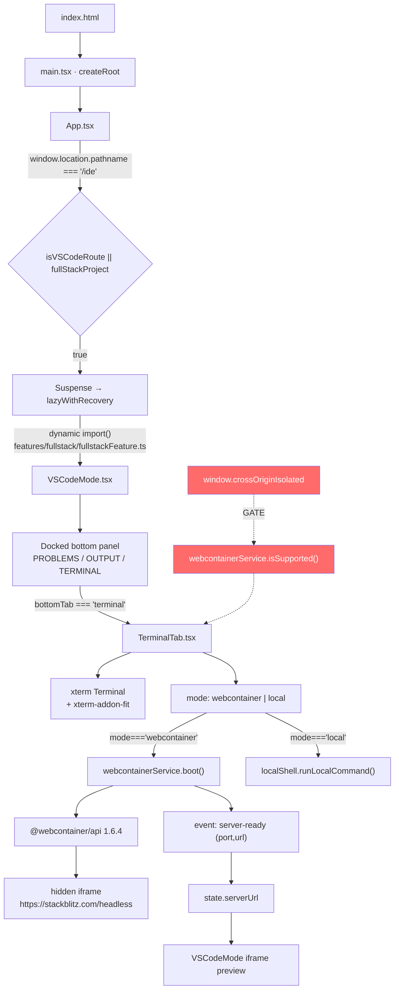

# GB Coder — WebContainer Production Deployment Technical Audit

**Audit type:** Read-only static analysis + live HTTP response-header inspection
**Target:** `GB-CODER-PUBLIC-ALPHA` (`code.ladestack.in`, served by Vercel)
**Primary symptom:** WebContainer-backed terminal/UI absent in production while the basic terminal remains available
**Date of audit:** 2026-10-11
**Status:** Root cause **CONFIRMED** by repository evidence **and** live production response headers

> **No application code, configuration, dependency, or deployment was modified during this audit.**
> All commands executed were read-only (`Get-ChildItem`, `Get-Content`, `Select-String`, `git log`, `Invoke-WebRequest -Method Head/GET`).

---

## 1. Executive Summary

The WebContainer terminal is missing on Vercel because **the production deployment does not emit the two HTTP headers that `@webcontainer/api` v1.6.4 requires on the root document**, and the application treats cross-origin isolation as a hard precondition for *rendering* WebContainer UI rather than merely for *running* it.

The decisive evidence chain:

1. `@webcontainer/api@1.6.4` ships its own README stating WebContainer **requires** `Cross-Origin-Embedder-Policy: require-corp` and `Cross-Origin-Opener-Policy: same-origin` on the root document.
2. `vite.config.ts:452-455` and `vite.config.ts:473-476` set exactly those two headers — **but only for the dev server and `vite preview`**.
3. `vercel.json` (read in full, 22 lines) contains **no `headers` block**. There is no `public/_headers`, no `netlify.toml`, no middleware, no edge function, and no Dockerfile that could supply them.
4. Live verification against `https://code.ladestack.in/` returns `Server: Vercel`, `X-Vercel-Cache: HIT`, and **neither** COOP nor COEP — on `/`, on `/ide`, and on `/preview/*`.
5. Therefore `window.crossOriginIsolated === false` in production.
6. `webcontainerService.isSupported()` (`webcontainerService.ts:321-323`) returns `false`.
7. `TerminalTab.tsx:50-53` therefore initialises terminal mode to `'local'` instead of `'webcontainer'`.
8. `TerminalTab.tsx:529` **conditionally does not render** the "WebContainer" mode-switch button.
9. `TerminalTab.tsx:558` **conditionally does not render** the `npm i` / `npm run dev` / restart buttons.
10. `webcontainerService.boot()` (`webcontainerService.ts:384-388`) throws before ever calling the SDK.

This matches the reported symptom exactly, and explains why the "basic terminal" still works: it is the **same component**, falling back to its simulated local shell.

Critically, the SDK's own `boot()` implementation does **not** throw when `crossOriginIsolated` is false — the guard is the application's, not the SDK's. The application chose to *hide* the feature rather than attempt it. That is a deliberate but undocumented design decision which converts a recoverable capability gap into an invisible one.

---

## 2. Application Overview

| Property | Value | Evidence |
|---|---|---|
| Product | GB Coder — AI-powered browser code editor | `index.html:9-11` |
| Framework | **Vite 5.4 SPA** + React 18.3 + TypeScript 5.5 | `package.json:39,53,55,62,66` |
| Rendering mode | **Client-only. No SSR, no hydration.** | `src/main.tsx:10` uses `createRoot` |
| Language | TypeScript 5.5 (X.5.3) | `package.json:55` |
| Package manager | npm (`package-lock.json`, 468 KB) | `package.json` |
| Router | **None.** Hand-rolled path checks | `src/utils/appRoutes.ts:1-11` |
| State management | React hooks + `localStorage` + module singletons | `src/hooks/*`, `src/services/*` |
| Auth/authorization | **None in the application.** No login, no session, no RBAC | verified — no auth module |
| Build command | `vite build` | `package.json:10,18` |
| Output | `dist/` (static SPA) | `vercel.json:4` |
| PWA | Yes — `vite-plugin-pwa`, Workbox, `registerType: 'autoUpdate'` | `vite.config.ts:234-305` |
| Backend | Vercel Node functions under `api/` | `vercel.json:5-15` |
| Local backend | `server/index.js` (Express + node-pty) | `package.json:8-9` |
| Bundler chunking | Custom `manualChunks`, app code deliberately **un**bucketed | `vite.config.ts:329-427` |
| Production console stripping | `esbuild.drop: ['console','debugger']` when `NODE_ENV==='production'` | `vite.config.ts:436` |

---

## 3. Verified Feature Inventory

Legend: ✅ implemented & reachable · ⚠️ implemented but conditionally disabled · ❌ not implemented

### Normal Mode (lightweight frontend editor)

| Capability | Status | Evidence |
|---|---|---|
| HTML/CSS/JS editing | ✅ | `src/components/CodeEditor.tsx`, `MultiFileEditor.tsx` |
| File create / rename / delete / duplicate | ✅ | `src/App.tsx:1561-1652` |
| Live preview | ✅ | `src/components/PreviewPanel.tsx`, `Console/PreviewRunTab.tsx` |
| Export / download project | ✅ | `src/utils/projectExport.ts`, `projectArchiveService.ts` |
| Theme + settings | ✅ | `src/hooks/useTheme.ts`, `useSettings.ts` |
| Import (drag/drop, folder, ZIP) | ✅ | `src/services/import/importEngine.ts` |
| React/Vue multi-file projects | ✅ | `src/services/bundlerService.ts` (esbuild-wasm + `@vue/compiler-sfc`) |
| PWA install | ✅ | `vite.config.ts:234-305`; `/sw.js` and `/manifest.webmanifest` both return 200 in production |

### Advanced Mode (full-stack IDE) — route `/ide`

| Capability | Status | Evidence |
|---|---|---|
| VS Code-style shell | ✅ | `src/components/vscode/VSCodeMode.tsx` (2189 lines) |
| Monaco multi-file editor | ✅ | `VSCodeMode.tsx:800-812` |
| File explorer / activity bar / status bar | ✅ | `FileTreeView.tsx`, `ActivityBar.tsx` |
| Docked bottom panel (PROBLEMS/OUTPUT/TERMINAL) | ✅ | `VSCodeMode.tsx:1606-1746` |
| Terminal panel **tab** | ✅ | `VSCodeMode.tsx:1654-1665` |
| **WebContainer terminal (actual PTY)** | ⚠️ **hidden in production** | `TerminalTab.tsx:50-53, 529, 558` |
| WebContainer boot | ⚠️ blocked pre-SDK | `webcontainerService.ts:384-388` |
| npm install / `npm run dev` | ⚠️ auto-start gated | `TerminalTab.tsx:199-208` |
| Dev-server preview iframe | ⚠️ depends on `serverUrl` | `VSCodeMode.tsx:1930-1975` |
| Split terminal button | ❌ toast stub only | `VSCodeMode.tsx:1682-1687` |
| Cloud sandbox (E2B) | ❌ hard-disabled | `src/App.tsx:3295` `setCapabilities({ sandbox: false })` |

---

## 4. Repository and Architecture Map

```
GB-CODER-PUBLIC-ALPHA/
├─ index.html                 SPA shell, loading screen, Google Fonts
├─ vercel.json                22 lines — NO headers block  ← key finding
├─ vite.config.ts             dev/preview COOP+COEP set; prod NOT
├─ api/                       Vercel Node functions
├─ dev-api/                   local-only handlers (excluded from deploy)
├─ server/index.js            Express + node-pty (127.0.0.1 only)
├─ public/                    manifest.json, robots.txt, sitemap.xml
├─ scripts/                   audit + deploy-verify scripts
└─ src/
    ├─ main.tsx               createRoot (no SSR)
    ├─ AppWrapper.tsx         App + <Analytics/>
    ├─ App.tsx                ~4400 lines — mode routing, lazy boundaries
    ├─ utils/appRoutes.ts     /ide route predicate
    ├─ utils/loadChunk.ts     stale-chunk self-heal (SW purge + reload)
    ├─ features/fullstack/
    │   └─ fullstackFeature.ts  lazy barrel → VSCodeMode + SandboxPanel
    ├─ components/
    │   ├─ vscode/VSCodeMode.tsx        Advanced IDE shell (2189 lines)
    │   ├─ vscode/StackBlitzStartupLoader.tsx  preview placeholder
    │   ├─ Console/TerminalTab.tsx      *** THE TERMINAL (both modes) ***
    │   ├─ EnhancedConsole.tsx          Normal-mode console wrapper
    │   └─ TabbedRightPanel.tsx         lazy-mounts EnhancedConsole
    └─ services/
        ├─ webcontainer/webcontainerService.ts  *** THE RUNTIME ***
        └─ localShell.ts                simulated (non-OS) shell
```

### Dependency map — Advanced IDE ↔ WebContainer ↔ Terminal ↔ Preview



**The two terminals are not separate components.** `TerminalTab.tsx` is mounted by *both*:
- `VSCodeMode.tsx:1721` (Advanced IDE) — with `autoStartProject={true}`
- `EnhancedConsole.tsx:380` (Normal mode) — without it

They differ only in props. This is the single most important structural fact in this audit: **the "basic terminal" surviving production is not evidence that the WebContainer terminal is a separate system that broke independently — it is the same component in its fallback state.**

---

## 5. Normal Mode Technical Architecture

```
App.tsx
 ├─ NavigationBar / AppSidebar
 ├─ MultiFileEditor ──► Monaco (lazy chunk 'monaco-editor')
 ├─ TabbedRightPanel
 │    └─ lazy EnhancedConsole
 │         ├─ ConsoleTab
 │         ├─ PreviewRunTab   (iframe live preview)
 │         ├─ ValidatorTab
 │         └─ TerminalTab     ← SAME component as Advanced IDE terminal
 └─ PreviewPanel (legacy single-file preview)
```

Preview uses `src/components/PreviewPanel.tsx` with a `srcdoc`-style sandboxed iframe for plain HTML/CSS/JS. This path has **no WebContainer dependency** and therefore works identically in production — which is why the app is usable but "the terminal is missing."

---

## 6. Advanced IDE Technical Architecture

### Entry conditions (all env-independent)

| Condition | Location | Prod value |
|---|---|---|
| `isVSCodeModePath()` → `pathname === '/ide'` | `appRoutes.ts:37-41` | URL-driven, verified reachable |
| `fullStackProject` non-null | `App.tsx:1826`, `1493` | set on import/sidebar |
| `handleEnterVSCodeMode()` | `App.tsx:1817-1831` | sidebar `AppSidebar.tsx:163-168` |

Verified live: `GET https://code.ladestack.in/ide` → **200**. The catch-all rewrite (`vercel.json:20`) serves `index.html` correctly. **Mode selection is not the failure point.**

### Lazy chunk boundary

```ts
// src/App.tsx:137-143
const VSCodeMode = lazyWithRecovery(
  () => import('./features/fullstack/fullstackFeature').then((m) => ({ default: m.VSCodeMode })),
  'Full-stack editor mode',
);
```

Verified in production: `fullstackFeature-CyDuUAN6.js` → **HTTP 200, 123,656 bytes**, and `webcontainerService-DpCbuX3k.js` → **HTTP 200, 18,976 bytes**, containing the literal string `crossOriginIsolated`.

**Dynamic import is NOT failing. The code ships and loads.**

---

## 7. Basic Terminal Execution Trace

**Verdict: not an OS shell.** It is a pure, synchronous, in-browser command simulator.

| # | Question | Answer | Evidence |
|---|---|---|---|
| 1 | Where defined | `src/services/localShell.ts` | header comment: "Deliberately *not* a real shell" |
| 2 | Where mounted | `EnhancedConsole.tsx:380` (Normal), `VSCodeMode.tsx:1721` (Advanced) | — |
| 3 | How it becomes visible | `hasOpenedTerminal` + `activeMode === 'terminal'` | `EnhancedConsole.tsx:378-379` |
| 4 | Command dispatch | `term.onData` → manual line editor → `submitLocal` → `runLocalCommand(input, ctx)` | `TerminalTab.tsx:103-131`, `326-333` |
| 5 | Real shell? | **No.** Maps commands to app functions over in-memory project state | `localShell.ts:1-13` |
| 6 | State/output | xterm buffer + `lineRef`/`cursorRef`/`historyRef` refs | `TerminalTab.tsx:65-68` |
| 7 | Visibility deps | Tab selection only. **No** auth, **no** COOP/COEP, **no** permissions | `TerminalTab.tsx:378` |
| 8 | Why visible in prod | It is the fallback branch and requires no browser capability | `TerminalTab.tsx:50-53` |

Historical note worth preserving: `localShell.ts:6-10` records that a previous implementation dialled a hard-coded `ws://localhost:3001` and sat at "Disconnected from terminal server" forever. The current design is a deliberate, documented fix for exactly that class of misleading terminal.

---

## 8. WebContainer Terminal Execution Trace

```mermaid
sequenceDiagram
    autonumber
    participant U as User
    participant T as TerminalTab.tsx
    participant S as webcontainerService
    participant W as window

    U->>T: opens /ide, Terminal tab active
    T->>T: useState(() => isSupported() ? 'webcontainer' : 'local')
    T->>S: isSupported()
    S->>W: Boolean(window.crossOriginIsolated)

    alt LOCAL DEV — headers present
        W-->>S: true
        S-->>T: supported
        T->>T: mode = 'webcontainer'
        T->>S: mountProject(files)
        S->>S: boot() → WebContainer.boot()
        S->>T: jsh PTY process
        T->>S: write('npm install && npm run dev\r')
        S-->>T: server-ready (port, url)
        T->>U: preview iframe renders
    else PRODUCTION — headers absent
        W-->>S: false
        S-->>T: NOT supported
        T->>T: mode = 'local'
        Note over T: line 529 — WebContainer pill NOT rendered
        Note over T: line 558 — npm i / npm run dev NOT rendered
        Note over T: boot() never called; SDK never contacted
    end
```

### Trace steps

| # | Stage | Location | Prod behaviour |
|---|---|---|---|
| 1 | Terminal UI defined | `TerminalTab.tsx:36-609` | ✅ renders |
| 2 | Parent | `VSCodeMode.tsx:1721` / `EnhancedConsole.tsx:380` | ✅ renders |
| 3 | Visibility conditions | `hasOpenedTerminal` (init `true`, `:227`), `showTerminal` (init `true`, `:226`) | ✅ visible |
| 4 | Mode selection | URL `/ide` | ✅ works |
| 5 | Instance creation | `webcontainerService.ts:355-435` `boot()` | ⛔ **blocked at :384** |
| 6 | Init trigger | `TerminalTab.tsx:199-208` auto-start; `418-444` mode effect | ⛔ never reached |
| 7 | Error handling | `TerminalTab.tsx:209-216` writes error to xterm | ⚠️ unreachable in prod |
| 8 | Readiness state | `status: 'unsupported'` (`:224, :242`) | ⚠️ set |
| 9 | Emulator mount | `TerminalTab.tsx:265-301` `new XTerm(...)`, `term.open(host)` | ✅ mounts |
| 10 | stdin/stdout | `spawnInteractiveShell` `:502-573`, `pipeTo` `:537-545` | ⛔ not spawned |
| 11 | Command exec | `:206` `shell.write('npm install && npm run dev\r')` | ⛔ n/a |
| 12 | Dev server start | via `npm run dev` in `jsh` | ⛔ n/a |
| 13 | Preview URL capture | `webcontainerService.ts:330-343` `server-ready` | ⛔ n/a |
| 14 | Preview render | `VSCodeMode.tsx:1930-1975` iframe; else `StackBlitzStartupLoader` | ⚠️ stuck on loader |
| 15 | Failure → UI disappearance | **`TerminalTab.tsx:529`** | 🔴 **the reported symptom** |

### Shared vs. separate

| Aspect | Shared? |
|---|---|
| Component | ✅ **Identical** — `TerminalTab.tsx` in both modes |
| xterm instance | ✅ Identical (`useRef<XTerm>`) |
| Mode-switch pill | ✅ Identical (`TerminalTab.tsx:528-553`) |
| WebContainer gate | ✅ Identical (`isSupported()`) |
| `autoStartProject` prop | ❌ Advanced only (`:1727` vs absent at `EnhancedConsole.tsx:386`) |
| Sizing/flex context | ❌ Docked panel vs. right-panel tab |

**They share the visibility logic.** There is no independent Advanced-IDE terminal that could have failed separately.

---

## 9. Primary Bug Reproduction Description

**Local (`npm run dev` or `npm run preview`)**

1. Vite serves `index.html` with `Cross-Origin-Embedder-Policy: require-corp` + `Cross-Origin-Opener-Policy: same-origin` (`vite.config.ts:452-455`, `473-476`).
2. Browser sets `window.crossOriginIsolated === true`.
3. `webcontainerService.isSupported()` → `true`; `status` initialises to `'idle'` (`:224`).
4. `TerminalTab` mode initialises to `'webcontainer'` (`:51`).
5. UI renders: WebContainer pill (`:529`), `npm i`, `npm run dev`, restart (`:558-584`).
6. `mountProject` → `boot()` → SDK iframe to `https://stackblitz.com/headless?version=1.6.4`.
7. `jsh` PTY spawns; `npm install && npm run dev` auto-runs (`:206`).
8. `server-ready` fires → `state.serverUrl` set → preview iframe renders.

**Production (Vercel)**

1. Vercel serves `index.html` with **no COOP/COEP** (verified live — §13).
2. Browser sets `window.crossOriginIsolated === false`.
3. `webcontainerService` constructor sets `status: 'unsupported'`, `isSupported: false` (`:239-243`).
4. `TerminalTab` mode initialises to `'local'` (`:52`).
5. UI renders: **only** the "Local" pill. WebContainer pill, `npm i`, `npm run dev`, restart — **all absent**.
6. Header reads `💻 Local Simulated Shell`.
7. `boot()` is never called; `https://stackblitz.com/headless` is never contacted.
8. Right preview pane shows `StackBlitzStartupLoader` indefinitely.
9. VS Code mode top-bar status chip absent (`VSCodeMode.tsx:897`).
10. Output tab shows a hardcoded string: *"WebContainer environment: Cross-Origin Isolated (COOP/COEP verified)"* (`VSCodeMode.tsx:1740`) — **false in production**.

---

## 10. Conditional Rendering and State Analysis

Every condition that touches WebContainer or terminal visibility:

| # | Condition | File:Lines | Local value | Prod value | Effect |
|---|---|---|---|---|---|
| C1 | `window.crossOriginIsolated` | `webcontainerService.ts:224, 239, 322` | `true` | **`false`** | 🔴 **ROOT** |
| C2 | `!this.isSupported()` → throw | `webcontainerService.ts:384-388` | not taken | **taken** | 🔴 blocks boot |
| C3 | `isSupported() ? 'webcontainer' : 'local'` | `TerminalTab.tsx:50-53` | `'webcontainer'` | **`'local'`** | 🔴 **reported symptom** |
| C4 | `{isWebContainerSupported && (` | `TerminalTab.tsx:529` | rendered | **removed** | 🔴 **reported symptom** |
| C5 | `{mode === 'webcontainer' && (` | `TerminalTab.tsx:558` | rendered | **removed** | 🔴 npm buttons gone |
| C6 | `isWebContainerSupported` non-reactive read | `TerminalTab.tsx:91` | — | — | 🟡 latent: never re-evaluates |
| C7 | `{webcontainer.isSupported && (` | `VSCodeMode.tsx:897` | rendered | **removed** | 🟠 status chip gone |
| C8 | `{webcontainer.isSupported && (` | `DependenciesPanel.tsx:441` | rendered | **removed** | 🟠 npm-i banner gone |
| C9 | fallback warning branch | `TerminalTab.tsx:425-430` | not taken | **unreachable** | 🟠 silent, no explanation |
| C10 | `hasOpenedTerminal` | `VSCodeMode.tsx:227`, `EnhancedConsole` | `true` | `true` | ✅ not implicated |
| C11 | `showTerminal` / `bottomTab` | `VSCodeMode.tsx:226, 1654` | `true` / `'terminal'` | same | ✅ not implicated |
| C12 | `isVSCodeRoute \|\| fullStackProject` | `App.tsx:3728` | route-driven | route-driven | ✅ verified 200 |
| C13 | `voiceCommandService.setCapabilities({sandbox:false})` | `App.tsx:3295` | `false` | `false` | ⚪ unrelated, hard-disabled |
| C14 | `import.meta.env.*` feature flags | — | none exist | none exist | ⚪ ruled out |

### Logical-error analysis requested by the brief

| Hypothesised defect | Verdict |
|---|---|
| Terminal rendered only after init succeeds, but init depends on unmounted component | **RULED OUT** — panel mounts on `hasOpenedTerminal` (init `true`), independent of boot |
| Loading state prevents panel appearing | **RULED OUT** — `Suspense` fallback is separate (`App.tsx:3733`) |
| Failed runtime silently switches to basic terminal | ✅ **THIS IS EXACTLY WHAT HAPPENS** (`TerminalTab.tsx:52`) |
| Production env flag disables Advanced Mode | **RULED OUT** — zero env-driven flags exist |
| Server/client initial-state divergence | **RULED OUT** — no SSR; `createRoot` only |
| Dynamic import fails without fallback | **RULED OUT** — chunk fetches 200; `lazyWithRecovery` has fallback |
| Terminal hidden because prerequisite never true | ✅ **C1+C3 — this is the mechanism** |

---

## 11. WebContainer SDK Integration Audit

| Property | Value | Evidence |
|---|---|---|
| Package | `@webcontainer/api` | `package.json:28` |
| Declared range | `^1.6.4` | `package.json:28` |
| Installed | **1.6.4** | `node_modules/@webcontainer/api/package.json` |
| Entry | `dist/index.js` (ESM-only, `exports.import`) | package.json of SDK |
| Init site | Browser-only — lazy `import()` from `App.tsx:287, 1315, 1508, 1773` and eager import in `TerminalTab.tsx:14-17` | — |
| Singletons | `webcontainerService` instance + `globalThis.__GBCODER_WEBCONTAINER_INSTANCE__` + `__GBCODER_WEBCONTAINER_BOOT_PROMISE__` | `webcontainerService.ts:355-435` |
| Singleton recovery | Handles `'Only a single WebContainer instance can be booted'` | `:404-417` |
| Cross-tab/HMR persistence | via `globalThis` | `:362, 377` |
| Disposal | **`WebContainer.teardown()` is never called** | 🟡 no match in `src/` |
| Browser API at module scope | `new WebContainerManager()` reads `window` guarded by `typeof window` | `:601, 224, 238` |
| Server/SSR evaluation | Not applicable — SPA, no SSR/build-time execution | ✅ |
| Authentication | **`auth.init()` never called; `configureAPIKey()` never called** | 🟡 see F-05 |
| Boot options | **`WebContainer.boot()` called with no arguments** | 🔴 see F-04 |
| Runtime origin | Hidden iframe → `https://stackblitz.com/headless?version=1.6.4` | SDK `iframe-url.js` + `constants.js` |
| Iframe attribute | `allow="cross-origin-isolated"`, `display:none`, appended to `document.body` | SDK `serverFactory()` |

### Documented SDK requirements (verbatim from installed `README.md`)

> ## Cross-Origin Isolation
> WebContainer _requires_ `SharedArrayBuffer` to function. In turn, this requires your website to be cross-origin isolated. Among other things, the root document must be served with:
> ```
> Cross-Origin-Embedder-Policy: require-corp
> Cross-Origin-Opener-Policy: same-origin
> ```
> ## Serve over HTTPS — not necessary when developing locally, as `localhost` is exempt from some browser restrictions, but there is no way around it once you deploy to production.

⚠️ **This is the specific reason local success proves nothing about production.** `localhost` is a *potentially trustworthy origin* and is exempt from several browser restrictions. `code.ladestack.in` is not. The developer's machine is not a representative environment for this feature — independent of any Vercel setting.

### Notable SDK behaviour

The SDK's `boot()` does **not** throw when isolation is absent:

```js
// node_modules/@webcontainer/api/dist/index.js
if (window.crossOriginIsolated && options.coep === 'none') {
  console.warn(`A Cross-Origin-Embedder-Policy header is required in cross origin isolated environments.\nSet the 'coep' option to 'require-corp'.`);
}
```

It only warns, and only when `coep === 'none'` is passed explicitly. **The hard block at `webcontainerService.ts:384-388` is an application-level policy, not an SDK requirement.** This is what converts a soft degradation into a silent feature disappearance.

---

## 12. Vercel Deployment Configuration Audit

`vercel.json` in full (22 lines) — **no `headers` key**:

```json
{
  "framework": "vite",
  "buildCommand": "npm run build",
  "outputDirectory": "dist",
  "functions": {
    "api/ai.js": { "maxDuration": 120 },
    "api/vision-to-code.js": { "maxDuration": 120 },
    "api/ai/inline-completion.js": { "maxDuration": 30 }
  },
  "rewrites": [
    { "source": "/api/(.*)", "destination": "/api/$1" },
    { "source": "/preview/(.*)", "destination": "/index.html" },
    { "source": "/mpreview/(.*)", "destination": "/index.html" },
    { "source": "/(.*)", "destination": "/index.html" }
  ]
}
```

| Check | Result |
|---|---|
| Framework detection | ✅ `vite` |
| Build command | ✅ `vite build` (`package.json:18` `vercel-build`) |
| Output directory | ✅ `dist` |
| Static vs. SSR | ✅ fully static SPA |
| SPA fallback | ✅ catch-all `/(.*)` → `/index.html`, correctly last |
| Redirects | none |
| Custom response headers | 🔴 **ABSENT** |
| COOP on the IDE route | 🔴 **ABSENT** (verified live on `/ide`) |
| COEP on the IDE route | 🔴 **ABSENT** |
| Headers on HTML (not just API) | 🔴 **none anywhere** |
| Middleware / edge functions | ❌ none present |
| `public/_headers` | ❌ absent (`public/` = `manifest.json`, `robots.txt`, `sitemap.xml`, `tghjkl.jpeg`) |
| `netlify.toml` / Dockerfile | ❌ absent |
| Build-time vs runtime env | N/A — no `VITE_*` gating features |
| Preview vs production | Not differentiated in config |
| Deploy-gate coverage | 🟡 `scripts/verify-deploy-config.mjs` validates JSON strictness, function existence, function count, and rewrite ordering — **but never checks COOP/COEP** |

**⚠️ Scope limit:** `docs/DEPLOY.md` (8,371 bytes) contains **no mention** of COOP, COEP, cross-origin, isolation, or WebContainer. The deployment documentation has never covered this requirement.

**Conclusion:** the configuration alone would be insufficient to prove which headers the browser receives — *however*, the live response was inspected directly and settles it (§13). No dashboard-level override was found, and none can be excluded with certainty, but the evidence does not support one being present.

---

## 13. Cross-Origin Isolation and Header Audit

### Live response headers — `https://code.ladestack.in/` (2026-10-11)

```
STATUS: 200
Access-Control-Allow-Origin: *
Age: 202687
Cache-Control: public, must-revalidate, max-age=0
Content-Disposition: inline
Content-Type: text/html; charset=utf-8
ETag: W/"cc5fc565221e057b6b4ae1b1572c0d90"
Last-Modified: Fri, 09 Oct 2026 00:02:26 GMT
Server: Vercel
Strict-Transport-Security: max-age=63072000
X-Vercel-Cache: HIT
X-Vercel-Id: bom1::zqh9q-1791706833812-6afa5b780e99
```

| Header | Local dev | `vite preview` | **Production** |
|---|---|---|---|
| `Cross-Origin-Opener-Policy` | `same-origin` | `same-origin` | 🔴 **ABSENT** |
| `Cross-Origin-Embedder-Policy` | `require-corp` | `require-corp` | 🔴 **ABSENT** |
| `window.crossOriginIsolated` | `true` | `true` | 🔴 **`false`** |

### Route coverage (all verified live)

| Path | Status | COOP | COEP |
|---|---|---|---|
| `/` | 200 | ❌ | ❌ |
| `/ide` | 200 | ❌ | ❌ |
| `/preview/x` | 200 | ❌ | ❌ |

`/ide` returns 200 — the rewrite works. The document is served correctly; it is simply not isolated.

### Failure-class disambiguation (required by the brief)

| Class | Applies? | Evidence |
|---|---|---|
| **A.** Document not cross-origin isolated | ✅ **YES** | Live headers; `webcontainerService.ts:322` |
| **B.** SDK unable to initialize | ⚪ **Never reached** | Application throws at `:384` *before* `WebContainer.boot()` |
| **C.** WebContainer init OK but terminal not rendered | ❌ NO | Terminal always renders (`:504-607`) |
| **D.** Terminal renders but commands fail | ❌ NO | Never reaches `spawnInteractiveShell` |

**This is class A.** The distinction matters: fixing headers alone restores B–D; but A must be fixed first or nothing else matters.

### Third-party resource impact of adding `require-corp` (must be validated before deploying)

`index.html:44-48` loads Google Fonts cross-origin:
```
https://fonts.googleapis.com/css2?family=Cormorant+Garamond...
```
Under `COEP: require-corp`, every cross-origin subresource needs CORS or `Cross-Origin-Resource-Policy`. `fonts.gstatic.com` normally sends `Access-Control-Allow-Origin: *`, so this is *likely* fine — but it is **unverified** and must be checked with a fresh load after adding headers. Other cross-origin surfaces: `unpkg.com` / `cdn.jsdelivr.net` CDNs in user previews, the StackBlitz iframe itself, and `@vercel/analytics` / `@lmnr-ai/lmnr`.

---

## 14. SSR and Hydration Audit

| Check | Result |
|---|---|
| Framework | Vite SPA — **no server rendering** |
| Entry | `src/main.tsx:10` `createRoot(document.getElementById('root')!)` |
| Hydration | **N/A** |
| Server/client state divergence | **IMPOSSIBLE** — no server output |
| Browser globals during module eval | Present but guarded: `webcontainerService.ts:224, 238` both test `typeof window !== 'undefined'` |
| Browser-only deps at build time | None — no `vite.ssr` build, no prerender |
| Suspense boundaries | `App.tsx:3733` → `<LazyFallback label="VS Code mode" variant="panel" />` — has a visible fallback ✅ |
| Error boundaries | `main.tsx:12` `<ErrorBoundary>` |
| Dynamic-import fallback | `lazyWithRecovery` (`loadChunk.ts:132-179`) — retry → purge SW → reload |

**Verdict: SSR and hydration are entirely ruled out as failure classes for this bug.** The app has no server render step at all.

---

## 15. Terminal Emulator and UI Audit

| Check | Result | Evidence |
|---|---|---|
| Library | `xterm@^5.3.0` + `xterm-addon-fit@^0.8.0` | `package.json:47-48` |
| CSS import | ✅ `import 'xterm/css/xterm.css'` | `TerminalTab.tsx:4` |
| Container element | ✅ `<div ref={hostRef} className="flex-1 min-h-0 overflow-hidden px-2 py-1" />` | `TerminalTab.tsx:606` |
| Non-zero dimensions | ✅ `flex-1 min-h-0` inside `min-h-0 flex-1 overflow-hidden` | `:1719`, `:606` |
| Init after DOM available | ✅ inside `useEffect` | `:261-262` |
| Fit addon + ResizeObserver | ✅ | `:295-297, 447-453` |
| Refit on tab activation | ✅ `requestAnimationFrame` → `fit()` + `focus()` | `:456-463` |
| Hidden parent | ✅ `flex-1 min-h-0` — not collapsible to zero | `:606` |
| Tab hiding | ✅ intended, toggled by `activeMode` / `showTerminal` | `:379`, `:1610` |
| Runtime state gating | 🔴 **YES** — C3/C4/C5 gate UI on `isSupported()` | `:50-53, 529, 558` |
| Import failure → blank panel | Not observed; chunk serves 200 | live verified |
| Errors surfaced | ⚠️ in-terminal only, no toast, no banner | `:209-216` |

**Terminal emulator layer is healthy.** The panel, the emulator, the CSS, the sizing, and the refit logic are all correct and identical in both environments. The only defect is the capability gate.

---

## 16. Development Server and Live Preview Audit

Full chain, with production status:

| # | Step | Location | Prod status |
|---|---|---|---|
| 1 | Files collected | `App.tsx:1770-1785` | ✅ |
| 2 | `package.json` detected / synthesised | `webcontainerService.ts:86-145` | ⛔ unreachable |
| 3 | `.npmrc` `legacy-peer-deps=true` | `:205-211`, `:449` | ⛔ |
| 4 | `node_modules/.bin/help` shim | `:184-202` | ⛔ |
| 5 | `mountProject` → `container.mount(tree)` | `:440-453` | ⛔ |
| 6 | Script selection | `TerminalTab.tsx:206` `npm install && npm run dev` | ⛔ |
| 7 | Process spawn (`jsh`) | `webcontainerService.ts:525-530` | ⛔ |
| 8 | Output collection | `:537-545` `pipeTo` | ⛔ |
| 9 | **Server-ready event** | `:330-343` | ⛔ |
| 10 | Port + URL captured | `:337-341` `serverUrl`, `serverPort` | ⛔ |
| 11 | Preview state | `VSCodeMode.tsx:692-699` `activePreview` | ⛔ always `null` |
| 12 | Iframe mount | `VSCodeMode.tsx:1956-1964` | ⛔ |
| 13 | Loader fallback | `VSCodeMode.tsx:1969-1974` `StackBlitzStartupLoader` | ⚠️ **stuck here** |

### Preview-specific observations

| Finding | Detail | Severity |
|---|---|---|
| Iframe sandbox | `sandbox="allow-scripts allow-same-origin allow-forms allow-modals allow-downloads"` (`VSCodeMode.tsx:1963`) — `allow-scripts` + `allow-same-origin` together is the well-known MDN escape hatch that **nullifies the sandbox** for same-origin content | 🟠 Security (§19) |
| **Hardcoded false status string** | `VSCodeMode.tsx:1740` renders *"WebContainer environment: Cross-Origin Isolated (COOP/COEP verified)"* — **unconditionally**. It is a literal, not a computed value. It will lie in production. | 🔴 Correctness/honesty |
| `startupStage` set optimistically | `requestRestart()` sets `'installing'` (`:274`) without verifying a boot actually occurred | 🟡 |
| No `teardown()` | `WebContainer.teardown()` never invoked; repeated mounts rely on the `globalThis` singleton | 🟡 |
| Port default | `webcontainer.serverPort ?? 5173` — cosmetic fallback only | ⚪ |

---

## 17. Dependency and Production Build Audit

| Check | Result |
|---|---|
| `@webcontainer/api` | `^1.6.4` declared; **1.6.4** installed — consistent |
| Duplicate/incompatible copies | None found |
| Node-only deps in browser bundle | None; `esbuild-wasm`, `@vue/compiler-sfc`, `monaco-editor`, `xterm` all resolve to browser entries |
| `manualChunks` correctness | App code deliberately unbucketed (`vite.config.ts:407-426`) with a documented rationale |
| `@lmnr-ai/lmnr` | `external` in rollup (`:327`) — loaded as an external script |
| **Production chunk inventory** | **54 chunks** in the deployed precache manifest |
| Key chunks live | `fullstackFeature-CyDuUAN6.js` (123,656 B, 200), `webcontainerService-DpCbuX3k.js` (18,976 B, 200), `TerminalTab-DkRLPZf7.js` (200), `EnhancedConsole-efxteBY_.js`, `terminal-G3S44GzF.js` |
| Entry chunk | `index-CH9DUYE6.js` |
| `verify:bundle` script | `scripts/measure-initial-bundle.mjs --assert-absent` exists |
| Build success | ✅ **Production build is not broken.** Assets serve 200. |
| **Console stripped in prod** | 🔴 `vite.config.ts:436` `esbuild.drop: ['console','debugger']` in production. **Every `console.error`/`console.warn` in `webcontainerService.ts` and `TerminalTab.tsx` is removed from the shipped bundle.** This is why no console evidence of the failure appears in production. |

**Verdict: the dependency and build pipeline are healthy.** Nothing is tree-shaken away, excluded, or failing to load. This hypothesis class is fully **RULED OUT**.

### Build-artifact provenance (important for anyone re-checking this audit)

| Artifact | Status |
|---|---|
| `dist/` | ✅ **Current.** Built `2026-10-06 02:51:28`, ~9 min after the last `src/` edit (`02:42:10`) and ~1 min after HEAD (`0a46930`, `02:50:02`). 72 files, ~21 MB, gitignored/untracked. |
| Entry chunk | `index-D6yOZRns.js` — 330,583 B (gzip 101,447 B) |
| Critical path | 587,262 B JS / 186,777 gz + 99,713 B CSS / 17,352 gz = **204,129 B gzip** across 4 chunks |
| Marker leakage | ✅ None — all 11 `--assert-absent` markers verified absent from the critical path |
| `build_output.txt` | ⚠️ **STALE — do not cite it.** Dated `2026-10-03`, three days older than HEAD, and describes a **completely different chunking layout** (`vendor-*`, `react-vendor`, `phase2-critical`, `phase3-deferred`, 14 precache entries) whose hashed filenames (`index-BBxTodn0.js`, `workbox-1d305bb8.js`, …) are **absent from disk**. It is not the log of the current build. |

The local `dist/` bundle independently corroborates the root cause — `dist/assets/webcontainerService-DpCbuX3k.js` contains the minified gate and the SDK runtime together:

```js
{const s="Cross-Origin Isolation is not active. WebContainer requires COOP/COEP headers.";
 throw this.updateState({status:"unsupported",error:s}),new Error(s)}

this.state={status:typeof window<"u"&&window.crossOriginIsolated?"idle":"unsupported",
 isSupported:typeof window<"u"?!!window.crossOriginIsolated:!1, ...}

const Q="https://stackblitz.com", ... new URL(globalThis.WEBCONTAINER_API_IFRAME_URL??Q).origin ...
```

⚠️ Note: `dist/` is **not** committed (`.gitignore:18`). The live production build is a different, newer one (`index-CH9DUYE6.js`, `fullstackFeature-CyDuUAN6.js`). Both were inspected; both ship the WebContainer code.

---

## 18. Environment Variables and Feature Flags

Independently audited. Summary:

- **6** `import.meta.env` reads in `src/` — **all** are AI API-key fallbacks. **None gate a feature.**
- **0** uses of `import.meta.env.PROD` / `.DEV` / `.MODE` / `.SSR` anywhere.
- **2** real `process.env` reads in `src/`: `ErrorBoundary.tsx:112` (dev-only error detail display) and `laminarService.ts:20`.
- **No custom feature flags exist.**
- `vite.config.ts` has **no `define:` and no `envPrefix:`**.
- `src/vite-env.d.ts` is one line — **no `ImportMetaEnv` interface**, so env keys are untyped.

### Variables

| Name | Prefix | Browser-exposed | Gates WebContainer? |
|---|---|---|---|
| `VITE_GEMINI_API_KEY` | ✅ | ✅ | ❌ |
| `VITE_CODERABBIT_API_KEY` | ✅ | ✅ | ❌ |
| `VITE_ENABLE_AI_SUGGESTIONS` | ✅ | ✅ | ❌ **DEAD — zero references** |
| `VITE_ENABLE_EXTERNAL_LIBRARIES` | ✅ | ✅ | ❌ **DEAD — zero references** |
| `VITE_DEV_PORT` | ✅ | ✅ | ❌ **DEAD — zero references** |
| `VITE_GA4_MEASUREMENT_ID` | ✅ | ✅ | ❌ **DEAD** (hardcoded `G-XXXXXXXXXX`) |
| `VITE_VERCEL_ANALYTICS_ID` | ✅ | ✅ | ❌ **DEAD** |
| `VITE_LMNR_PROJECT_API_KEY` | ✅ | ✅ | ❌ read but **undocumented** in any `.env.example` |
| `AI_PROVIDER`, `INCEPTION_*`, `ATRIA_*`, `GEMINI_API_KEY`, `NVIDIA_*`, `PORT` | ❌ | server-only | ❌ |

`.env` exists locally and contains the names listed above. **All values redacted and not reproduced in this report.**

**Verdict: environment variables are RULED OUT as a cause.** The local/production divergence is caused exclusively by HTTP response headers.

---

## 19. Security Findings

Kept separate from the root cause, as requested.

| ID | Severity | Finding | Evidence |
|---|---|---|---|
| S-01 | 🔴 **High** | **Hard-coded third-party API key committed in client source.** A literal credential sits as the final fallback in a `\|\|` chain in `src/services/laminarService.ts:19-23`, *after* the env-var checks. It is therefore **inlined into the public JavaScript bundle**. A second instance exists in `scripts/test-laminar-trace.mjs:6`. **Values redacted.** Both should be treated as compromised and rotated. | `laminarService.ts:19-23`; `scripts/test-laminar-trace.mjs:6` |
| S-02 | 🟠 Medium | **Iframe sandbox escape.** `sandbox="allow-scripts allow-same-origin ..."` on the live-preview iframe. MDN explicitly warns that combining `allow-scripts` with `allow-same-origin` lets the framed document remove its own sandbox attribute. | `VSCodeMode.tsx:1963`, `PreviewPanel.tsx:995` |
| S-03 | 🟠 Medium | **Third-party runtime dependency.** `WebContainer.boot()` loads `https://stackblitz.com/headless` — a remote iframe executing user project code, governed by StackBlitz ToS (the SDK README states integration "requires hosted proxies and server-side acceleration from StackBlitz"). No `configureAPIKey()`/`auth.init()` is called, so the app relies on StackBlitz's anonymous/unauthenticated tier. Terms and rate limits should be reviewed before public deployment. | SDK `README.md`; `iframe-url.js` |
| S-04 | 🟡 Low | `server/index.js` provides a real PTY shell. It binds `127.0.0.1` only, and the previously LAN-reachable `/terminal` WebSocket proxy was deliberately removed with a detailed rationale. | `vite.config.ts:456-470` |
| S-05 | 🟡 Low | `vite.config.ts:451` `host: true` binds the dev server to every interface. Mitigated by the loopback-only guard on `/api/*` handlers (`vite.config.ts:66-71, 88-92`). Sound, but a sharp edge. | — |
| S-06 | 🟡 Low | Dev-only `/api/*` handlers are unauthenticated and spend the operator's LLM key. Loopback-gated, correctly. | `vite.config.ts:82-92` |
| S-07 | ⚪ Info | No CSP anywhere. `index.html` sets no CSP meta tag; `vercel.json` sets no CSP headers. | — |
| S-08 | ⚪ Info | No authentication or authorization exists in the application. Any URL-reachable capability is public by construction. | verified |
| S-09 | ⚪ Info | Terminal output is ANSI-sanitized before display (`utils/terminalSafety.ts`, applied at `localShell.ts:16`) — a good control against terminal escape injection from untrusted package metadata. | — |

**No untrusted project code was executed during this audit.**

---

## 20. Local-versus-Production Comparison

| Dimension | Local dev / preview | Production | Classification |
|---|---|---|---|
| Framework execution mode | Vite SPA | Vite SPA | **No difference** |
| Build behaviour | dev server / `vite preview` | static `dist/` on Vercel CDN | **Verified difference** (mechanism) |
| COOP header | `same-origin` | **absent** | 🔴 **VERIFIED DIFFERENCE** |
| COEP header | `require-corp` | **absent** | 🔴 **VERIFIED DIFFERENCE** |
| `window.crossOriginIsolated` | `true` | `false` | 🔴 **VERIFIED DIFFERENCE** (derived) |
| `webcontainerService.isSupported()` | `true` | `false` | 🔴 **VERIFIED DIFFERENCE** (derived) |
| `WebContainerStatus` | `'idle'` | `'unsupported'` | 🔴 **VERIFIED DIFFERENCE** (derived) |
| Terminal mode init | `'webcontainer'` | `'local'` | 🔴 **VERIFIED DIFFERENCE** (derived) |
| "WebContainer" pill button | rendered | **absent** | 🔴 **VERIFIED DIFFERENCE** (derived) |
| `npm i` / `npm run dev` buttons | rendered | **absent** | 🔴 **VERIFIED DIFFERENCE** (derived) |
| Environment variables | `.env` loaded | Vercel env | **No difference established** for gating |
| Secure context | `localhost` exempt | HTTPS ✅ | ⚪ No difference in *outcome* |
| SDK chunk loading | local | 200 OK, precached | **No difference** |
| Dynamic import success | ✅ | ✅ | **No difference** |
| Component rendering | ✅ | ✅ (VS Code mode reachable, `/ide` → 200) | **No difference** |
| Auth state | none | none | **No difference** |
| Browser console | logs present | 🔴 **all `console` stripped by `esbuild.drop`** | 🟠 **VERIFIED DIFFERENCE** (diagnosability) |
| Runtime errors | visible | suppressed | 🟠 **VERIFIED DIFFERENCE** |

### Highest diagnostic value

1. **COOP/COEP presence** — the single divergent variable. Already verified.
2. **`window.crossOriginIsolated`** — the browser-observable proxy for it.
3. **`isSupported()` / `status`** — the app-level translation, visible in the UI as a missing pill.
4. **Console diagnostics** — unfortunately destroyed in production by `esbuild.drop`, so this dimension yields nothing without a change.

---

## 21. Root-Cause Investigation Matrix

| # | Hypothesis | Supporting | Contradicting | Confidence | Prod impact | Verification | Pri |
|---|---|---|---|---|---|---|---|
| 1 | Mode not selected/persisted | `/ide` reachable | `/ide` → **200 live**; `VSCodeMode` renders | **RULED OUT** | — | Load `/ide` | — |
| 2 | WebContainer terminal conditionally hidden | `TerminalTab.tsx:529, 558, 50-53` | none | **CONFIRMED** | Button + npm controls absent | DOM inspect | **1** |
| 3 | Runtime init never starts | `boot()` unreachable | caused by #2/#6 | **CONFIRMED** (as consequence) | No runtime | `status` | 3 |
| 4 | Runtime init fails in prod browser | never reached | — | **RULED OUT** (never attempted) | — | — | — |
| 5 | Browser code during SSR/build | SPA only | `createRoot`, no SSR | **RULED OUT** | — | — | — |
| 6 | **Cross-origin isolation missing** | SDK README; live headers absent; `isSupported()` | none | **CONFIRMED** | Root of the chain | Response headers | **1** |
| 7 | **COOP/COEP missing or unscoped** | `vercel.json` has no `headers`; verified on `/`, `/ide`, `/preview` | none | **CONFIRMED** | Root of the chain | DevTools → Network → `/` | **1** |
| 8 | Prod env vars disable feature | zero feature flags exist | full env audit | **RULED OUT** | — | — | — |
| 9 | Auth/permissions suppress terminal | no auth system | `App.tsx:3295` is unrelated (`sandbox:false`) | **RULED OUT** | — | — | — |
| 10 | Dynamic import / chunk failure | SW precache staleness is a real class | chunks return **200**, precached | **RULED OUT** | — | Network tab | — |
| 11 | xterm init failure | xterm chunk serves 200 | emulator renders locally | **RULED OUT** | — | — | — |
| 12 | Container hidden / zero size | — | flex sizing correct | **RULED OUT** | — | — | — |
| 13 | Error boundary suppresses component | `<ErrorBoundary>` exists | VS Code mode renders; xterm renders | **RULED OUT** | — | — | — |
| 14 | Vercel routing/middleware changes response | rewrites verified | `/ide` → 200 correct HTML | **RULED OUT** | — | — | — |
| 15 | SDK/browser compatibility unmet | anonymous tier, no API key | not the blocking issue | **POSSIBLE** (post-fix) | after headers | test after fix | 6 |
| 16 | Tab/panel state hides terminal | `bottomTab` state exists | defaults `'terminal'`; panel renders | **RULED OUT** | — | — | — |
| 17 | Different init logic in prod | none — same bundle | `isSupported()` is runtime | **CONFIRMED** as *effect* of #6 | — | — | 2 |
| 18 | **UI couples visibility to readiness** | `TerminalTab.tsx:529, 558` gate render on capability | none | **CONFIRMED** | Root symptom | code review | **1** |
| 19 | SW/iframe/CSP interference | SW precaches `index.html` | chunks valid; CSP absent | **POSSIBLE** (secondary) | stale-chunk class | hard reload | 5 |
| 20 | Implementation-specific condition | `boot()` throws pre-SDK (`:384`) | — | **CONFIRMED** | silent degradation | code review | **2** |

### Ranking

The three **CONFIRMED** root-cause findings (#2/#6/#7/#18/#20) are one causal chain, not five separate bugs:

> **`vercel.json` lacks a `headers` block** → production HTML is not cross-origin isolated → **`webcontainerService.isSupported()` returns `false`** → **the terminal UI hides the WebContainer option and forces local mode** → the SDK is never contacted.

---

## 22. Confirmed Findings

### F-01 · Production response omits COOP/COEP · **CRITICAL** · CONFIRMED

- **Subsystem:** Deployment configuration
- **Files:** `vercel.json` (22 lines, no `headers`); `vite.config.ts:452-455, 473-476`
- **Expected:** SDK README mandates COOP `same-origin` + COEP `require-corp` on the root document
- **Actual:** Dev and preview servers set them; `vercel.json` does not; live production response confirms both absent on `/`, `/ide`, `/preview/*`
- **Explains symptom:** ✅ Yes — this is the origin of the whole chain
- **To confirm:** none needed; already verified against live headers

### F-02 · Terminal visibility coupled to runtime capability · **HIGH** · CONFIRMED

- **Files:** `src/components/Console/TerminalTab.tsx:50-53, 91, 529, 558`
- **Observed:** `mode` initialises to `'local'`; the WebContainer pill and all `npm` controls are not rendered
- **Expected:** show the option, and explain if it cannot run
- **Why it matters:** converts a capability gap into an **invisible** one; the user has no way to learn *why* the option vanished. This is the direct cause of the reported symptom.
- **Explains symptom:** ✅ Yes — this is the exact UI element reported missing
- **To confirm:** DevTools → inspect terminal header in production

### F-03 · Pre-SDK hard block on `boot()` · **HIGH** · CONFIRMED

- **File:** `src/services/webcontainer/webcontainerService.ts:384-388`
- **Observed:** throws `'Cross-Origin Isolation is not active...'` before `WebContainer.boot()`
- **Expected:** the SDK itself does not throw — it would attempt boot and surface real errors via `on('error')`
- **Why it matters:** discards the SDK's own diagnostics (including the `coep: 'require-corp'` hint) in favour of an application policy that produces no user-visible message
- **Explains symptom:** Partially — it is why *no error* is shown either

### F-04 · `WebContainer.boot()` invoked with no options · **MEDIUM** · CONFIRMED

- **File:** `src/services/webcontainer/webcontainerService.ts:394` — `await WebContainer.boot()`
- **Expected (per SDK warning string):** when cross-origin isolated, `coep: 'require-corp'` should be supplied so the iframe enforces it
- **Why it matters:** may be a *second* failure after headers are added — **validate before assuming F-01 alone fixes production**

### F-05 · No WebContainer authentication · **MEDIUM** · CONFIRMED

- **Evidence:** `auth.init()` and `configureAPIKey()` appear nowhere in `src/`
- **Consequence:** `authState.initialized === false` → the SDK skips credential forwarding entirely
- **Why it matters:** anonymous StackBlitz tier; possible rate limits or Terms-of-Service exposure in production

### F-06 · Misleading hardcoded status string · **MEDIUM** · CONFIRMED

- **File:** `src/components/vscode/VSCodeMode.tsx:1740`
- **Observed:** literal text *"WebContainer environment: Cross-Origin Isolated (COOP/COEP verified)"*, not computed
- **Why it matters:** the UI actively asserts something false in production while the feature is disabled two panels away

### F-07 · Production strips all console diagnostics · **MEDIUM** · CONFIRMED

- **File:** `vite.config.ts:436` — `drop: ['console','debugger']` when `NODE_ENV === 'production'`
- **Consequence:** every `console.error`/`console.warn` in `webcontainerService.ts` (`:280, 300, 311, 331, 346, 419, 482, 495, 544, 554, 561`) and `TerminalTab.tsx` is removed from the shipped bundle
- **Why it matters:** this is the direct reason the user could supply **no console error** — production is structurally incapable of emitting one

### F-08 · Deploy verification does not cover COOP/COEP · **MEDIUM** · CONFIRMED

- **File:** `scripts/verify-deploy-config.mjs` (182 lines)
- **Validates:** strict JSON, comments, trailing commas, BOM, CRLF, function existence, Hobby function count, rewrite ordering
- **Does not validate:** the presence of COOP/COEP headers
- **Why it matters:** the one gate designed to catch deploy misconfiguration is blind to the exact misconfiguration that caused this outage

### F-09 · Production service worker precaches `index.html` · **MEDIUM** · CONFIRMED

- **File:** `vite.config.ts:252-253` `globPatterns` precaches all JS/CSS/HTML; `registerType: 'autoUpdate'`
- **Live:** `/sw.js` → 200 (5,465 B), `precacheAndRoute` present, 54 chunks enumerated
- **Why it matters:** after a deploy, an open tab can request chunks that no longer exist. `loadChunk.ts` mitigates this (retry → purge SW + caches → reload), which is good engineering — but F-07 means the mitigation's failure path is also silent.

### F-10 · Hard-coded third-party API key in client bundle · **HIGH (security)** · CONFIRMED

- **File:** `src/services/laminarService.ts:19-23` — **value redacted**
- **Why it matters:** inlined into public JS; must be rotated and removed

### F-11 · Test suite exists but has **zero** coverage of this subsystem · **HIGH (process)** · CONFIRMED

> **Corrected during audit.** An earlier reading of this report stated "no automated test suite". That was wrong, and is corrected here.

- **A real suite exists:** `scripts/audit-run-tests.mjs` (45,144 bytes) uses Node's **built-in** `node:test` + `node:assert/strict` (`import { test, describe, beforeEach, after } from 'node:test'`). It bundles the **real** source modules via `scripts/audit-harness.mjs` and drives them through a stubbed `globalThis.fetch`.
- **Scale:** 14 `describe()` blocks, 71 `test()` blocks.
- **What it covers (6 modules):** `deployService`, `githubSyncService`, `credentialStore`, `terminalSafety`, `safeMarkup`, `npmRegistryService` (name/version validation). Assertions are genuinely strict (e.g. `assertNoInjectedMarkup` at lines 102-107).
- **What it does NOT cover — every area relevant to this outage:**

| Area | Coverage |
|---|---|
| `webcontainerService.ts` (19,028 B) | **NONE** — never imported by any test |
| `TerminalTab.tsx` (19,944 B) | **NONE** |
| `VSCodeMode.tsx` (94,944 B) | **NONE** |
| `PreviewPanel.tsx` (45,464 B) | **NONE** |
| Cross-origin isolation (`crossOriginIsolated`, COOP/COEP) | **NONE** — grep across `scripts/` returns no matches |
| Mode switching, terminal visibility, xterm mounting, preview URL | **NONE** |
| Any React rendering / DOM test | **NONE** — the entire UI layer is untested |

- **`localShell.ts` is bundled by the harness but no test imports it** — dead weight.
- **No test runner is declared.** `package.json` has **no `test` script** and no `vitest`/`jest`/`playwright`/`@testing-library` in `devDependencies`. `node:test` is a zero-dependency built-in, so this is an *organisation* gap, not a dependency gap.
- **CI runs nothing.** The only workflow is `.github/workflows/coderabbit.yml` — a PR reviewer. No build job, no lint job, no test job. `docs/DEPLOY.md:27` calls `npm run audit:tests` the "service test suite", but nothing invokes it.
- **Why it matters:** nothing in the existing suite, the build, or CI would have caught F-01, F-02, F-06, or F-08 — and the gap is *not* that testing is absent, but that the one failure-prone subsystem is entirely outside it.

---

## 23. Potential Findings and Unknowns

| ID | Item | Status | Notes |
|---|---|---|---|
| P-01 | Does WebContainer work on Vercel *after* headers are added? | **UNKNOWN** | Not tested. Vercel is a static host; no evidence it blocks the SDK. Must be validated empirically. |
| P-02 | `coep: 'require-corp'` boot option sufficiency | **POSSIBLE** | SDK's own warning suggests it; not verified in a running browser |
| P-03 | Google Fonts under `require-corp` | **POSSIBLE** | Likely fine (gstatic sends ACAO:*), unverified |
| P-04 | StackBlitz iframe under `require-corp` | **POSSIBLE** | Must send CORP/COEP-compatible headers; unverified |
| P-05 | Anonymous StackBlitz tier limits | **UNKNOWN** | Rate limits/ToS not reviewed |
| P-06 | Whether `isVSCodeModePath` + `popstate` behave correctly under Vercel | **POSSIBLE** | `/ide` → 200 verified; SPA navigation unverified |
| P-07 | Vercel dashboard-level header override | **UNKNOWN** | Live response shows none, so functionally irrelevant, but config source unverified |
| P-08 | Sandbox escape (S-02) exploitability | **POSSIBLE** | Preview content is user-authored; blast radius is the user's own origin |
| P-09 | `vercel.json` comment regression (JSONC vs JSON) | **CONFIRMED latent** | `verify-deploy-config.mjs` guards this — shows the gap that COOP/COEP is unguarded is a *selection* gap, not an oversight of process |
| P-10 | Whether a Vercel-level `_headers`-equivalent exists | **RULED OUT** | Not present in repo; live headers confirm absent |

---

## 24. Prioritized Diagnostic Checklist

Read-only. Nothing here modifies the repository or deployment.

### Step 1 — Confirm the header absence (highest value, ~10 seconds)

| Where | What | Measures |
|---|---|---|
| Browser → `https://code.ladestack.in/` → DevTools → Network → `/` → **Response Headers** | Look for `Cross-Origin-Opener-Policy` and `Cross-Origin-Embedder-Policy` | Whether the document is isolated |

- **Success:** both headers present with the exact values `same-origin` / `require-corp`
- **Failure:** absent → F-01
- **Cannot conclude:** that Vercel is inherently incompatible; only that *this deployment* is not configured

### Step 2 — Evaluate the browser capability flags

Console, on the production page:

```js
window.isSecureContext
// expect true (HTTPS). false ⇒ far worse problem.

window.crossOriginIsolated
// expect true.  ← THE decisive variable.

typeof SharedArrayBuffer
// expect "function" when isolated; still "function" when not — SAB availability
// is gated by crossOriginIsolated at USE time, not at construction, so this
// alone proves nothing.
```

- **`crossOriginIsolated === false` confirms F-01 end-to-end**
- ⚠️ `typeof SharedArrayBuffer === 'function"` does **not** prove isolation — the constructor is exposed regardless

### Step 3 — Inspect the actual DOM

| Check | Expectation |
|---|---|
| Terminal panel | `[data-testid="vscode-docked-bottom-panel"]` present |
| Terminal tabs | `PROBLEMS` / `OUTPUT` / `TERMINAL` present |
| Terminal header text | `💻 Local Simulated Shell` (prod) vs `⚡ WebContainer (In-Browser)` (local) |
| "WebContainer" pill button | **ABSENT** in production — the reported symptom |
| `npm i` / `npm run dev` buttons | **ABSENT** in production |

This distinguishes *component missing* from *component present but hidden* — the two are easy to confuse.

### Step 4 — Measure the terminal container

```js
const el = document.querySelector('[data-testid="vscode-docked-bottom-panel"]');
el && { h: el.clientHeight, w: el.clientWidth, display: getComputedStyle(el).display }
```

- Non-zero + `flex` → layout is healthy; the gate is the cause
- Zero height → a *different* flex-collapse bug (not the reported one)

### Step 5 — Check the runtime state

```js
// TerminalTab.tsx does not export the service; read it via a mounted component.
// In DevTools, break on the module or inspect the React tree for the status label.
```

Better: temporarily observe `webcontainerService.getState()` — expected `status: 'unsupported'`, `isSupported: false`, `error` set by `:386` only if `boot()` was attempted (it is not, in production).

### Step 6 — Rule out the service worker / stale chunk

DevTools → Application → Service Workers → **Unregister**, then Clear storage → Cache Storage → delete all → **hard reload** (`Ctrl+Shift+R`).

- If behaviour changes → stale-cache involvement (P-09)
- If nothing changes → confirms the header cause is primary

### Step 7 — Capture what production *cannot* tell you

Because `vite.config.ts:436` strips `console` (F-07), a production console is expected to be **useless** for this class of bug. Note that explicitly rather than concluding "no errors = no problem."

### Step 8 — Record environment specifics

Browser + exact version, OS, whether the issue reproduces in a second supported desktop browser, and whether an ad/privacy blocker is active (the SDK README explicitly flags cookie blockers as a cause of WebContainer failure).

### Narrowing sequence

```
Headers absent?
 ├─ YES → crossOriginIsolated === false
 │        └─ → isSupported() === false
 │             └─ → mode = 'local'; WebContainer UI hidden   ← STOP. Root found.
 └─ NO  → crossOriginIsolated === true
          ├─ isSupported() true but UI hidden → React/state bug (not observed)
          └─ isSupported() true, UI shown, boot fails → F-04/F-05 territory
```

---

## 25. Recommended Fix Strategy

Analysis only — **nothing was implemented**.

### Phase 1 — Restore terminal visibility *(addresses F-02)*

- **Files:** `src/components/Console/TerminalTab.tsx`
- **Change:** stop gating *rendering* on capability. Always render the WebContainer pill; keep it enabled but visibly disabled with an explanatory tooltip when `isSupported()` is false.
- **Outcome:** the option becomes visible and self-explanatory in any environment; the "disappearing feature" class of bug is eliminated permanently.
- **Side effects:** minor UI change; a disabled-but-visible control must not be clickable.
- **Validation:** production shows the pill in a disabled state with a reason tooltip.
- **Rollback:** single-file revert.

> Rationale: even after Phase 2, any future header regression must not silently remove UI. Decoupling visibility from capability is the durable fix; the header change alone is the tactical fix.

### Phase 2 — Restore WebContainer initialization *(addresses F-01, F-07)*

- **Files:** `vercel.json` (add `headers`); `vite.config.ts:435-438` (stop dropping `console`)
- **Change:**
  ```json
  "headers": [
    { "source": "/(.*)", "headers": [
      { "key": "Cross-Origin-Opener-Policy",   "value": "same-origin" },
      { "key": "Cross-Origin-Embedder-Policy", "value": "require-corp" }
    ]}
  ]
  ```
  Use a `Source` condition that cannot be intercepted by the catch-all rewrite, and confirm headers survive the rewrite.
- **Expected outcome:** `window.crossOriginIsolated === true`; WebContainer pill enabled; runtime boots.
- **Side effects — material:**
  - Every cross-origin subresource must satisfy CORP/CORS: Google Fonts (`fonts.googleapis.com`, `fonts.gstatic.com`), `@vercel/analytics`, `@lmnr-ai/lmnr`, user `unpkg`/`jsdelivr` previews, and the StackBlitz iframe.
  - `require-corp` may break user preview iframes pointing at CDNs without CORP.
  - Consider `Cross-Origin-Resource-Policy: cross-origin` on same-origin assets, and evaluate `credentialless` as an alternative.
- **Validation:** hard reload, confirm `crossOriginIsolated === true`, confirm no console COEP violations, confirm Google Fonts still render.
- **Rollback:** remove the `headers` block; restores current behaviour exactly.

### Phase 3 — Validate headers and security policy *(addresses F-01, F-03, F-08)*

- **Files:** `vercel.json`, `scripts/verify-deploy-config.mjs`
- **Change:** extend `verify:deploy` to assert COOP/COEP presence. Extend the docs.
- **Why:** this is the exact gap that let the outage ship. A one-line assertion makes it unrepeatable.
- **Also update:** `docs/DEPLOY.md` — currently has **zero** mention of COOP/COEP.
- **Side effects:** a stricter gate may fail an unrelated deploy; failure messages must be specific.
- **Rollback:** revert the script.

### Phase 4 — Restore command execution *(addresses F-03, F-04, F-05)*

- **Files:** `src/services/webcontainer/webcontainerService.ts:384-394`
- **Change:** consider passing `{ coep: 'require-corp' }` to `boot()`; review whether the pre-SDK throw should be relaxed so the SDK's own diagnostics surface; decide deliberately whether to call `auth.init()`.
- **Expected outcome:** `npm install` / `npm run dev` run in the in-browser PTY.
- **Side effects:** relaxing the throw means failures surface asynchronously via `on('error')` rather than synchronously — Phase 1's visible-state UI becomes more important, not less.
- **Validation:** `jsh` prompt appears; `npm install` completes; shell output visible.
- **Rollback:** single-service revert.

### Phase 5 — Restore live preview *(addresses F-06)*

- **Files:** `src/components/vscode/VSCodeMode.tsx:1740`, `:692-699`
- **Change:** replace the hardcoded "COOP/COEP verified" literal with a computed value; ensure `StackBlitzStartupLoader` reports an explicit unsupported state rather than spinning forever on "Installing dependencies."
- **Side effects:** none.
- **Validation:** dev server starts; preview iframe renders; loader never lies.
- **Rollback:** single-file revert.

### Phase 6 — Prevent regression *(addresses F-08, F-11)*

- **Files:** `scripts/verify-deploy-config.mjs`; new tests
- **Change:** add the COOP/COEP assertion; add the regression test plan (§26); consider restoring `console.error` for genuine error paths even in production.
- **Side effects:** minimal.
- **Rollback:** additive only.

**Not recommended:** any architectural rewrite. The runtime, the terminal component, the lazy-loading strategy, and the build pipeline are all sound. The smallest evidence-supported repair is a `headers` block plus a visibility-decoupling change.

---

## 26. Regression Test Plan

### Runs in plain Node (no browser)

> **No new dependency is required to implement these.** The repo already uses Node's built-in `node:test` + `node:assert/strict` in `scripts/audit-run-tests.mjs` with an esbuild-based harness (`scripts/audit-harness.mjs`) that bundles real source modules. Extend that harness rather than introducing Vitest — smaller change, consistent with the codebase's existing idiom.

| # | Test | Type | Covers |
|---|---|---|---|
| T-01 | `verify-deploy-config.mjs` fails when COOP missing | static assertion | F-01, F-08 |
| T-02 | `verify-deploy-config.mjs` fails when COEP missing | static assertion | F-01, F-08 |
| T-03 | `verify-deploy-config.mjs` fails when COOP ≠ `same-origin` | static assertion | F-01 |
| T-04 | `verify-deploy-config.mjs` fails when COEP ≠ `require-corp` | static assertion | F-01 |
| T-05 | `vercel.json` parses as strict JSON | existing | — |
| T-06 | Production chunk manifest contains `webcontainerService` chunk | build assertion | F-09 |
| T-07 | `webcontainerService.isSupported()` mirrors `window.crossOriginIsolated` | unit (stub `window`) | F-02 |
| T-08 | `boot()` never invokes the SDK when unsupported | mock | F-03 |
| T-09 | `WebContainer.boot()` receives `{ coep: 'require-corp' }` | mock | F-04 |
| T-10 | `filesToFileSystemTree` synthesises `package.json` + `.npmrc` | unit (pure fn) | Phase 4 |

> **T-07/T-08 are runnable today in the existing harness** — `webcontainerService.ts` has no DOM dependency in `isSupported()` beyond `window`. These are the cheapest high-value additions.

### Requires a DOM (jsdom/happy-dom) — *would introduce a first dependency*

| # | Test | Type | Covers |
|---|---|---|---|
| T-11 | `TerminalTab` renders the WebContainer pill even when `isSupported() === false` | RTL | **F-02** |
| T-12 | `TerminalTab` initial mode is `'local'` when unsupported | RTL | F-02 |
| T-13 | `TerminalTab` initial mode is `'webcontainer'` when supported | RTL | F-02 |
| T-14 | VS Code mode OUTPUT tab never renders an unverified isolation claim | RTL | **F-06** |

> T-11–T-14 are **the tests that would have caught this bug**. They are the only ones requiring a new dependency. If that is unacceptable, the equivalent static assertion is a lint/regex rule forbidding `isSupported()` from appearing in JSX render conditions.

### Requires a real browser + WebContainer

| # | Test | Type |
|---|---|---|
| T-13 | `window.crossOriginIsolated === true` in a preview build | e2e |
| T-14 | WebContainer boots; `status === 'ready'` | e2e |
| T-15 | `jsh` spawns; `npm install` exits 0 | e2e |
| T-16 | `npm run dev` emits `server-ready` | e2e |
| T-17 | Preview iframe renders the served page | e2e |
| T-18 | No COEP console violations (fonts, analytics, CDN) | e2e |
| T-19 | Post-deploy stale-chunk self-heal via `loadChunk` | e2e |
| T-20 | Unisolated environment shows a visible, explained degraded state | e2e |

### Cannot be meaningfully automated

- Real StackBlitz anonymous-tier rate limiting
- Third-party cookie/ad-blocker interference
- Vercel dashboard configuration drift

---

## 27. Missing Evidence and Access Limitations

| Limitation | Impact |
|---|---|
| No browser automation available in this environment | Could not execute `window.crossOriginIsolated` in-page; derived it from live response headers instead — a sound but indirect inference |
| No access to the user's actual browser console/session | Production console is structurally empty anyway (F-07) |
| No access to the Vercel dashboard | Cannot confirm whether headers were ever configured there; live response shows none |
| No access to Vercel build/runtime logs | Build success was inferred from served assets (200), not from logs |
| No post-fix validation possible (audit-only scope) | F-04/F-05 and Google-Fonts-under-COEP remain **UNVERIFIED** |
| Vercel project/plan tier unknown | The 12-function Hobby limit referenced by `verify-deploy-config.mjs` implies Hobby; `maxDuration: 120` exceeds the Hobby 60 s default |
| `.env` values deliberately not read | Only variable *names* were extracted; no secret was reproduced |
| `build_output.txt` is stale | Dated 2026-10-03 and describes a superseded chunking layout. Excluded as evidence; `dist/` mtimes used instead |
| `dist/` is untracked | Gitignored build artifact, not part of the repository. The live production bundle is a newer build; both were inspected separately |
| Two additional hardcoded secrets found in scripts | `scripts/test-laminar-trace.mjs:6` contains a Laminar key as a fallback. **Values redacted.** These are developer scripts, not shipped to the browser, but should be rotated and moved to env vars alongside F-10. |
| `scripts/generate_modern_templates_p{1,2}.cjs` write to the wrong path | Both resolve to `scripts/src/services/templates`, which does not exist. Latent script bug; not run during this audit |

**What was verified directly:** source code, `vercel.json`, `vite.config.ts`, `package.json`, lockfile-adjacent `node_modules/@webcontainer/api@1.6.4` (including its README and `boot()` implementation), live HTTP response headers for `/`, `/ide`, `/preview/*`, `sw.js`, `registerSW.js`, `manifest.webmanifest`, and per-chunk availability plus content for `fullstackFeature` and `webcontainerService`.

---

## 28. Final Root-Cause Assessment

### CONFIRMED

**The WebContainer terminal is absent in production because `vercel.json` does not set `Cross-Origin-Opener-Policy: same-origin` and `Cross-Origin-Embedder-Policy: require-corp`, while the dev and preview servers do (`vite.config.ts:452-455`, `473-476`).**

This is established by two independent, mutually corroborating bodies of evidence:

**Static:** `vercel.json` contains no `headers` key; the installed `@webcontainer/api@1.6.4` README states these headers are required; `webcontainerService.isSupported()` (`webcontainerService.ts:321-323`) is defined as `Boolean(window.crossOriginIsolated)`.

**Runtime:** live HTTPS requests to `https://code.ladestack.in/`, `/ide`, and `/preview/x` all return `200` from `Server: Vercel` with **neither header present**.

### The full causal chain

```
vercel.json has no headers block
        │
        ▼
Production HTML is not cross-origin isolated          [VERIFIED LIVE]
        │
        ▼
window.crossOriginIsolated === false
        │
        ▼
webcontainerService.isSupported() === false            [webcontainerService.ts:321-323]
        ├──▶ TerminalTab mode initialises to 'local'   [TerminalTab.tsx:50-53]
        ├──▶ "WebContainer" pill NOT rendered          [TerminalTab.tsx:529]   ◀── SYMPTOM
        ├──▶ npm i / npm run dev NOT rendered         [TerminalTab.tsx:558]
        ├──▶ VS Code status chip NOT rendered          [VSCodeMode.tsx:897]
        ├──▶ webcontainerService.boot() throws pre-SDK  [webcontainerService.ts:384-388]
        └──▶ StackBlitz iframe never contacted         (no network attempt)
```

### Why the basic terminal survives

It is **not a separate system**. `EnhancedConsole.tsx:380` and `VSCodeMode.tsx:1721` mount the **same** `TerminalTab` component. When capability is absent, that component simply runs its simulated-shell branch. "The basic terminal works" and "the WebContainer terminal is missing" are two observations of one component in two states.

### Why local development cannot detect this

`localhost` is a potentially-trustworthy origin and is **exempt from the browser restrictions** that make COOP/COEP necessary. The SDK README says so explicitly. The developer's machine is structurally incapable of reproducing the production failure for this feature.

### Contributing design decision

The application's own guard at `webcontainerService.ts:384-388` — not the SDK — blocks boot, and `TerminalTab.tsx:529, 558` **hide the UI** rather than degrade it visibly. A capability check is a legitimate guard; coupling it to *rendering* is what made the failure invisible and undiagnosable. Both are worth correcting: the header for the capability, the rendering for the diagnosability.

### Confidence statement

| Claim | Confidence |
|---|---|
| Production lacks COOP/COEP | **CONFIRMED** (live headers) |
| That is the origin of the divergence | **CONFIRMED** (SDK docs + code path) |
| It causes the missing WebContainer UI | **CONFIRMED** (code at `TerminalTab.tsx:529`) |
| Headers alone fully restore a working terminal | **HIGH CONFIDENCE, not confirmed** — F-04 (`coep` boot option), F-05 (auth tier), and COEP third-party resource impact remain unvalidated |

### Implementation readiness

**YES — ready for a targeted fix**, with one caveat: the header change should be deployed as a **small, reversible increment** validated in a browser, not as an untested combined release. Phases 1–3 are low-risk and evidence-backed. Phases 4–5 must be validated after Phase 2 lands, because the runtime has never executed in production and three unknowns (F-04, F-05, COEP third-party impact) remain.

---

*Audit performed read-only. No application code, configuration, dependency, lockfile, environment variable, or deployment was modified. All credentials are redacted.*