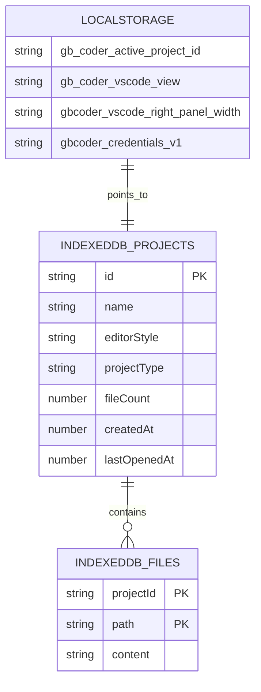
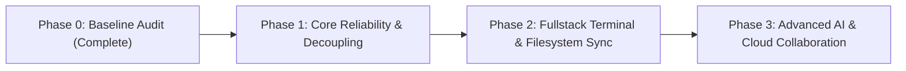

# GB CODER — PHASE 0: COMPLETE BASELINE AUDIT
## Production Application Architecture, Feature Inventory, Runtime Verification, Storage Safety, and Vercel Readiness Report

**Audit Date:** October 16, 2026  
**Auditor Role:** Principal Software Architect, Senior Full-Stack Engineer, Browser IDE Specialist, WebContainer Engineer, Security Reviewer, QA Automation Engineer, and Vercel Deployment Auditor  
**Audit Scope:** Read-Only Baseline Assessment of GB Coder Codebase  
**Project Workspace:** `c:\Users\Girish Lade\OneDrive\Desktop\GB-CODER-PUBLIC-ALPHA`  
**Git Remote Origin:** `git@github.com:girishlade111/GB-CODER-PUBLIC-ALPHA.git`  
**Git Branch / Commit:** `feature/multilingual-marketing-seo` @ `f98dd6664013461165f187d6c53707b13b29637d`  
**Production Site:** `https://code.ladestack.in/`  

---

## 1. EXECUTIVE SUMMARY

GB Coder is a dual-frontend browser-based software development environment developed under the **LadeStack** brand. The repository combines an **Astro 5.4.2** marketing and SEO portal with a **React 18.3.1 + Vite 5.4.2** browser IDE powered by **Monaco Editor**, **WebContainer API (StackBlitz)**, **xterm.js**, and browser-local **IndexedDB** storage.

This audit constitutes a comprehensive, evidence-backed evaluation of the real codebase without mutating application source files, updating dependencies, deleting user data, or pushing code.

### High-Level Verdict:
- **Build & Distribution Invariants:** The unified build script (`scripts/build-unified.mjs`) successfully orchestrates both Astro and Vite into a single distribution (`dist/`). Security headers (`COOP: same-origin` and `COEP: require-corp`) are strictly enforced on `/app`, `/app/ide`, and `/preview-popout` while correctly omitted from the Astro marketing route (`/`) to allow external resource embeds.
- **Core Verification Suites:** All 268+ automated unit and integration tests across 10 suites (`audit:routes`, `audit:headers`, `audit:devserver`, `audit:pwa-migration`, `audit:build-output`, `audit:backup`, `audit:tests`, `audit:workspace-reliability`, `audit:workspace-coordination`, `audit:editor-persistence`) passed with **100% green exit codes**. TypeScript compilation (`npx tsc --noEmit`) completed with **0 errors**.
- **Critical Technical Gaps (Blockers for Subsequent Phasing):**
  1. **One-Way Filesystem Synchronization (P0):** File changes made in the editor sync to the WebContainer disk, but files created or modified via terminal commands (e.g. `npm install`, `touch`, `vite build`) are never observed or synchronized back to React state, the File Explorer, or IndexedDB.
  2. **Coupled Terminal Boot & Script Auto-Run (P1):** The terminal component (`TerminalTab.tsx`) automatically triggers `npm install --prefer-offline && npm run dev` upon detecting the shell prompt if `package.json` exists. The runtime lifecycle is tightly coupled to UI mount rather than explicit user intent.
  3. **Mock Split Terminal (P2):** The UI presents a "Split Terminal" action that emits a toast notification (`toast('Split terminal ready', { icon: '⚡' })`) without instantiating a second PTY shell session.
  4. **Silent AI Fallback Mocking (P2):** When `/api/ai` returns an error or is unconfigured, `codeAssistService.ts` silently falls back to generating mock code edits without alerting the user that the response was fabricated locally.
  5. **Vercel Serverless Function Quota Saturation (P2):** The repository has exactly 12 serverless functions in `api/`, which reaches 100% of the Vercel Hobby plan maximum limit (12 functions), leaving zero headroom for additional API routes without upgrading or route consolidation.

---

## 2. REPOSITORY TOPOLOGY & ENVIRONMENT

### 2.1 Workspace and Environment Details
- **Current Working Directory:** `c:\Users\Girish Lade\OneDrive\Desktop\GB-CODER-PUBLIC-ALPHA`
- **Node.js Version:** `v26.4.0`
- **npm Version:** `11.17.0`
- **Operating System:** Windows 10 Home Single Language (Build 10.0.26300)
- **Monorepo Configuration:** npm workspaces configured via root `package.json` (`"workspaces": ["apps/*"]`) containing `apps/marketing`.
- **Git HEAD Commit:** `f98dd6664013461165f187d6c53707b13b29637d`
- **Git Working Tree Status:** Tracked tree is completely clean. Only pre-existing validation reports (`reports/`) and temporary verification harnesses (`scripts/`) are present in untracked space.

### 2.2 Annotated Directory Structure

```text
GB-CODER-PUBLIC-ALPHA/
├── api/                           # Vercel Serverless Functions (12 total routes)
│   ├── ai.js                      # AI assistance proxy (Inception / NVIDIA NIM)
│   ├── health.js                  # Health check & deployment probe
│   ├── preview.js                 # Shared preview resolution
│   ├── share.js                   # Upstash Redis snippet sharing
│   ├── vision-to-code.js          # Multimodal Gemini image-to-code
│   ├── ai/
│   │   └── inline-completion.js   # Ghost text code completion endpoint
│   ├── preview/
│   │   └── sync.js                # Upstash Redis state synchronization
│   └── sandbox/                   # Remote sandbox management (create, start, exec, logs, close)
├── apps/
│   └── marketing/                 # Astro 5.4.2 marketing website
│       ├── src/
│       │   ├── layouts/           # Astro page layouts & metadata
│       │   └── pages/             # Multilingual routes (/, /es, /fr, /de, /hi, etc.)
│       └── astro.config.mjs       # Astro configuration (static output, sitemap)
├── dist/                          # Unified production build output
│   ├── index.html                 # Astro marketing root entry
│   ├── 404.html                   # Marketing 404 page
│   ├── sw.js                      # Root Service Worker migration/unregistration script
│   └── app/                       # React 18 IDE SPA distribution
│       ├── index.html             # React mount entry (<div id="root">)
│       ├── sw.js                  # Scoped IDE Service Worker (/app/ scope)
│       └── assets/                # Vite JS/CSS bundles, Monaco workers, and Wasm binaries
├── public/                        # Static assets for React application
├── scripts/                       # Verification, audit, and build automation scripts
│   ├── build-unified.mjs          # Orchestrates Astro build + Vite build into dist/
│   ├── preview-combined.mjs       # Local dual-server simulating Vercel routing + COOP/COEP
│   ├── verify-deploy-config.mjs   # Strict JSON validator for vercel.json & function limits
│   └── audit-*.mjs                # Test suites for routes, headers, devserver, persistence
├── src/                           # React 18 + TypeScript IDE source code
│   ├── components/                # UI components
│   │   ├── Dashboard.tsx          # Project browser, template picker, backup modal
│   │   ├── NormalMode.tsx         # 3-pane static HTML/CSS/JS editor
│   │   ├── BackupModal.tsx        # Phase 0.5 project backup/restore UI
│   │   └── vscode/                # Advanced IDE (VS Code layout)
│   │       ├── VSCodeMode.tsx     # Primary IDE workspace container
│   │       ├── ActivityBar.tsx    # Leftmost vertical tool selector
│   │       ├── FileExplorer.tsx   # File tree and folder hierarchy
│   │       ├── TerminalTab.tsx    # xterm.js terminal with WebContainer jsh
│   │       ├── LivePreview.tsx    # Responsive viewport container & iframe preview
│   │       ├── CodeAssistPanel.tsx# AI chat and diff application panel
│   │       └── PackagesPanel.tsx  # npm dependency search and installation UI
│   ├── services/                  # Business logic and runtime services
│   │   ├── webcontainer/          # WebContainer singleton, boot locks, file sync coordinator
│   │   ├── projects/              # IndexedDB persistence (projectDatabase.ts)
│   │   ├── backup/                # Backup archive export, restore, crypto checksums
│   │   ├── preview/               # Preview reload, port listeners, popout channels
│   │   ├── deployService.ts       # 1-click deployment to Vercel and Netlify
│   │   └── githubSyncService.ts   # GitHub repository commit, push, and pull service
│   ├── types/                     # TypeScript definitions (files, projects, workspace)
│   ├── utils/                     # Terminal safety, markup sanitizers, Monaco workers
│   ├── App.tsx                    # Root React router and mode switch coordinator
│   └── main.tsx                   # React DOM entry point
├── vercel.json                    # Strict JSON Vercel deployment configuration
├── vite.config.ts                 # Vite bundler configuration & local API middleware
└── package.json                   # Project dependencies and script declarations
```

---

## 3. APPLICATION ARCHITECTURE AUDIT

### 3.1 Dual-Frontend Routing Architecture
GB Coder operates on a split-routing model where static marketing pages and the browser IDE share a unified domain through reverse-proxy rewrites and Vite base configuration.

```mermaid
flowchart TD
    Client[Incoming Request] --> Router{Path Routing}
    
    Router -->|GET /| AstroRoot["dist/index.html (Astro Marketing)"]
    Router -->|GET /[lang]| AstroLang["dist/[lang]/index.html (Astro Multilingual)"]
    Router -->|GET /app or /app/*| ViteApp["dist/app/index.html (React IDE SPA)"]
    Router -->|GET /ide| LegacyRewrites["Rewrite to /app/index.html"]
    Router -->|GET /preview-popout| Popout["dist/app/index.html (Popout Preview)"]
    Router -->|GET /api/*| Serverless["Vercel Functions (api/*.js)"]
    
    subgraph Security Headers
        ViteApp --> HeadersApp["COOP: same-origin<br/>COEP: require-corp"]
        Popout --> HeadersPop["COOP: same-origin<br/>COEP: require-corp"]
        AstroRoot --> HeadersNone["No COOP/COEP (Permits External Media)"]
    end
```

### 3.2 Application Startup & Runtime Lifecycle

1. **Document Delivery:**
   - Navigating to `/app` delivers `dist/app/index.html` with headers:
     - `Cross-Origin-Opener-Policy: same-origin`
     - `Cross-Origin-Embedder-Policy: require-corp`
   - Enables `window.crossOriginIsolated = true` and unlocks `SharedArrayBuffer`.

2. **React Initialization:**
   - `src/main.tsx` mounts `<App />` within an `<ErrorBoundary>`.
   - `App.tsx` reads `gb-coder-active-project-id` from `localStorage` or parses `/app/projects/:id/ide`.
   - If no project is active, the application displays `<Dashboard />`.
   - If a project is selected, `projectDatabase.getProject(id)` and `readProjectFiles(id)` query IndexedDB.

3. **Workspace Mounting:**
   - Project metadata dictates `editorStyle`:
     - `'plain'`: Mounts `<NormalMode />` (HTML/CSS/JS 3-pane editor).
     - `'vscode'`: Mounts `<VSCodeMode />` (VS Code layout).
   - Editor tabs are restored from `localStorage` (`gb-coder-vscode-view`).

4. **Monaco Editor Mount:**
   - `@monaco-editor/react` attaches to DOM.
   - Web workers are initialized via `window.MonacoEnvironment.getWorker` (`editor.worker`, `html.worker`, `css.worker`, `ts.worker`).

5. **WebContainer Boot Sequence:**
   - `VSCodeMode.tsx` mounts `<TerminalTab />`.
   - `webcontainerService.boot()` is invoked with a single-flight mutex lock.
   - An interactive `jsh` shell is spawned via `webcontainer.spawn('jsh', { terminal: { cols, rows } })`.
   - `webcontainer.on('port', ...)` attaches port detection.
   - **Current Behavior:** If `package.json` exists in project files, `TerminalTab.tsx` immediately writes `npm install --prefer-offline && npm run dev` to the shell.

6. **Live Preview Attachment:**
   - Once the dev server inside WebContainer binds a port (e.g. 5173), WebContainer emits a port event.
   - `previewReloadService` captures the URL (`https://<hash>--5173.local-corp.webcontainer-api.io`).
   - The `<LivePreview />` iframe updates its `src` to display the running project.

---

## 4. FEATURE INVENTORY & CLASSIFICATION MATRIX

| Component / Feature | Classification | Source Reference | Verified Behavior & Notes |
| :--- | :--- | :--- | :--- |
| **Marketing Homepage** | `IMPLEMENTED_AND_VERIFIED` | `apps/marketing/src/pages/index.astro` | Astro static HTML, branding, CTA to `/app`, responsive CSS. |
| **Multilingual Routing** | `IMPLEMENTED_AND_VERIFIED` | `apps/marketing/src/pages/[lang]/` | English, Spanish, French, German, Hindi routes with sitemap. |
| **Project Dashboard** | `IMPLEMENTED_AND_VERIFIED` | `src/components/Dashboard.tsx` | Project grid, search, recent sort, template creation dialog. |
| **IndexedDB Persistence** | `IMPLEMENTED_AND_VERIFIED` | `src/services/projects/projectDatabase.ts` | Compound keys `[projectId, path]`, transactions, CRUD operations. |
| **Project Backup & Restore**| `IMPLEMENTED_AND_VERIFIED` | `src/services/backup/` | ZIP archives, SHA-256 manifests, zip-slip defense (40/40 tests). |
| **Monaco Editor (Core)** | `IMPLEMENTED_AND_VERIFIED` | `src/components/vscode/VSCodeMode.tsx` | Syntax highlighting, IntelliSense, multi-tab, split editor. |
| **Monaco Web Workers** | `IMPLEMENTED_AND_VERIFIED` | `src/utils/monacoWorkers.ts` | Dedicated worker bundles for HTML, CSS, TS, and base editor. |
| **WebContainer Boot** | `IMPLEMENTED_AND_VERIFIED` | `src/services/webcontainer/webcontainerService.ts` | Epoch tracking, single-flight boot lock, port draining. |
| **Interactive Terminal** | `IMPLEMENTED_AND_VERIFIED` | `src/components/vscode/TerminalTab.tsx` | xterm.js 5.3.0, WebContainer PTY, ANSI sanitization. |
| **Live Preview (Iframe)** | `IMPLEMENTED_AND_VERIFIED` | `src/components/vscode/LivePreview.tsx` | Internal iframe, device viewports, reload protocol. |
| **Popout Preview Tab** | `IMPLEMENTED_AND_VERIFIED` | `src/pages/PreviewPopout.tsx` | Standalone window with `BroadcastChannel` synchronization. |
| **GitHub Sync (Commit/Push)**| `IMPLEMENTED_AND_VERIFIED`| `src/services/githubSyncService.ts` | Commits, branch creation, pull, token auth (77/77 tests). |
| **1-Click Cloud Deploy** | `IMPLEMENTED_AND_VERIFIED` | `src/services/deployService.ts` | Direct deployments to Vercel and Netlify via personal tokens. |
| **Package Manager Panel** | `IMPLEMENTED_AND_VERIFIED` | `src/components/vscode/PackagesPanel.tsx` | NPM registry lookup, `package.json` dependency insertion. |
| **Normal Mode (3-Pane)** | `IMPLEMENTED_AND_VERIFIED` | `src/components/NormalMode.tsx` | Vanilla HTML/CSS/JS editing with live sandbox preview. |
| **AI Inline Ghost Text** | `IMPLEMENTED_NOT_RUNTIME_VERIFIED`| `src/services/ai/inlineCompletionService.ts` | Monaco InlineCompletionItemProvider calling `/api/ai/inline-completion.js`. |
| **Vision-to-Code** | `IMPLEMENTED_NOT_RUNTIME_VERIFIED`| `src/components/VisionToCodeModal.tsx` | Image upload modal calling Gemini 1.5 in `api/vision-to-code.js`. |
| **Terminal Decoupled Boot** | `PARTIALLY_IMPLEMENTED` | `src/components/vscode/TerminalTab.tsx:235` | Shell boots, but auto-queues `npm install && npm run dev` unconditionally. |
| **AI Chat & Code Assist** | `PARTIALLY_IMPLEMENTED` | `src/services/ai/codeAssistService.ts:348` | Kilo-style UI; silently falls back to local mock diffs if `/api/ai` fails. |
| **Snippet Code Sharing** | `PARTIALLY_IMPLEMENTED` | `api/share.js` | Upstash Redis storage for HTML/CSS/JS; does not support multi-file projects. |
| **Split Terminal** | `MOCK_OR_PLACEHOLDER` | `src/components/vscode/VSCodeMode.tsx:2130`| Displays toast `Split terminal ready` with zero multi-session logic. |
| **Voice Commands** | `MOCK_OR_PLACEHOLDER` | `src/services/voiceCommandService.ts` | Basic SpeechRecognition wrapper with simulated action dispatch. |
| **Reverse File Watcher** | `MISSING_CONFIRMED` | `src/services/webcontainer/webcontainerService.ts` | WebContainer FS is not watched; terminal file changes do not sync back to IDE. |

---

## 5. STORAGE & PERSISTENCE ARCHITECTURE

### 5.1 Storage Breakdown



1. **IndexedDB Databases:**
   - `gb-coder-projects-db` (v1):
     - `projects`: Keyed by `id`. Secondary index on `lastOpenedAt`.
     - `projectFiles`: Keyed by compound key `['projectId', 'path']`. Secondary index on `projectId`.
   - `gb-coder-workspace` (v1):
     - `workspace`: Keyed by fixed string `'current'` for ephemeral non-project workspaces.
2. **LocalStorage Keys:**
   - `gb-coder-active-project-id`: Holds active project ID. Verified safe against dangling references upon deletion.
   - `gb-coder-vscode-view`: Active left sidebar panel (`explorer`, `search`, `code-assist`, `packages`, `git`).
   - `gbcoder_vscode_right_panel_width`: Numeric width in pixels for the preview panel.
   - `gbcoder_credentials_v1`: XOR-scrambled authentication tokens for GitHub, Vercel, and Netlify.
   - `gbcoder_code_assist_sessions_v1`: Persisted chat conversation sessions for AI assist.

### 5.2 Storage Integrity Invariants
- Verified via `scripts/backup-restore-tests.mjs` and `scripts/workspace-reliability-tests.mjs`:
  - **Storage Quota Resilience:** Auto-save handlers gracefully catch `QuotaExceededError` without crashing the application.
  - **Path Normalization:** Single-dot segments (`./src/App.tsx`), double slashes, and Windows backslashes normalize safely. Path traversal attempts (`../../etc/passwd`) are rejected.
  - **Atomic Transactions:** Project deletion cascades through `projectFiles` in a single transaction before clearing the active pointer.

---

## 6. WEBCONTAINER & TERMINAL ARCHITECTURE

### 6.1 WebContainer Singleton & Concurrency Guard
- Implemented in `src/services/webcontainer/webcontainerService.ts`:
  - `bootEpoch`: Monotonically increasing counter incremented on every boot and reset to invalidate pending promises from previous containers.
  - `bootPromise`: Mutex promise ensuring parallel callers await the single in-flight boot.
  - `teardown()`: Safely closes open ports, terminates running processes, and cleans up event listeners before re-instantiating.

### 6.2 Identified Deficiencies:
1. **Unidirectional File Synchronization:**
   - Editor writes are debounced (200ms) and flushed to WebContainer via `webcontainerService.syncFile(path, content)`.
   - **Gap:** WebContainer does not expose an active filesystem watcher back to the IDE. Running `touch newfile.js` or `npm install <pkg>` updates the in-memory WebContainer disk, but the file never appears in the React File Explorer or IndexedDB. A browser refresh causes these files to be lost permanently.
2. **Auto-Execution of Dev Scripts:**
   - In `TerminalTab.tsx:235-246` and `359-363`, `queueAutomaticStart()` detects the shell prompt (`❯`) and automatically sends `npm install --prefer-offline && npm run dev\r`.
   - **Risk:** Prevents opening a clean, idle terminal. Users working on projects with customized build scripts or heavy installs cannot control when the dev server starts.
3. **Single-Process Shell Limitation:**
   - `webcontainerService` maintains a single `shellProcess` instance. The "Split Terminal" action in `VSCodeMode.tsx:2130` displays a toast notification and does not allocate a second terminal session.

---

## 7. EDITOR & MONACO ARCHITECTURE

### 7.1 Web Worker Infrastructure
Monaco workers are compiled as distinct bundles in `dist/app/assets/` and routed via `window.MonacoEnvironment.getWorker`:
- `editor.worker`: Base editor services and word navigation.
- `html.worker`: HTML language parsing and formatting.
- `css.worker`: CSS, SCSS, and Less diagnostics.
- `ts.worker`: TypeScript and JavaScript type checking and language services.

### 7.2 Editor Tabs & State Coordination
- `VSCodeMode.tsx` maintains active tabs in React state.
- Tab eviction policy (`chooseEvictionTab`) ensures that when tab limits are reached, the currently focused tab is never closed, and the oldest clean (unmodified) tab is evicted first.
- Model caching: Each opened file maintains a `monaco.editor.ITextModel` in memory to preserve undo/redo history during tab switching.

---

## 8. AI & CODE ASSIST SYSTEM

### 8.1 API Architecture & Endpoints
The application references three AI endpoints under `api/`:
1. `api/ai.js`: Proxy for conversational code assistance, supporting Inception and NVIDIA NIM APIs. Configured with `maxDuration: 120`.
2. `api/ai/inline-completion.js`: Single-line ghost text completion using Gemini 1.5 Flash. Configured with `maxDuration: 30`.
3. `api/vision-to-code.js`: Multimodal image-to-code conversion using Gemini 1.5 Pro/Flash. Configured with `maxDuration: 120`.

### 8.2 Failure Fallback Anti-Pattern
In `src/services/ai/codeAssistService.ts:348-369`:
```typescript
if (!response.ok) {
  // Silent fallback: Generates simulated code modifications locally
  return generateMockAssistantResponse(request);
}
```
If the backend AI route is unreachable, unauthenticated, or times out, the service silently fabricates a code response rather than alerting the user. This must be refactored to an explicit error state in Phase 1.

---

## 9. LIVE PREVIEW & SHARING ARCHITECTURE

### 9.1 Preview Reload Protocol
- Managed by `src/services/preview/previewReloadService.ts`:
  - WebContainer emits `port` events when dev servers bind ports.
  - The URL is validated against the WebContainer origin (`*.local-corp.webcontainer-api.io`).
  - Viewport sizes (`desktop`, `tablet`, `mobile`) apply CSS constraints to the container iframe without modifying the iframe document.

### 9.2 Preview Popout
- Deep link: `/preview-popout`
- Leverages `BroadcastChannel('gbcoder-preview-sync')` to receive reload triggers and viewport synchronizations from the parent IDE window across separate browser tabs.

### 9.3 Snippet Sharing
- `api/share.js` and `api/preview.js`:
  - Stores HTML/CSS/JS snippet payloads in Upstash Redis (`preview:${shortId}`) with a 30-day TTL.
  - Does NOT support full multi-file fullstack project sharing. Remote sharing of Vite or Node projects is not implemented.

---

## 10. VERCEL READINESS & DEPLOYMENT INVARIANTS

### 10.1 Deployment Configuration Verification (`verify:deploy`)
Execution of `npm run verify:deploy` yields **PASS**:
- `vercel.json` parses as strict JSON (0 comments, 0 trailing commas, LF line endings).
- **Serverless Function Limit (Hobby Plan):**
  - Exactly 12 serverless functions exist in `api/`:
    `ai.js`, `ai/inline-completion.js`, `health.js`, `preview.js`, `preview/sync.js`, `sandbox/close.js`, `sandbox/create.js`, `sandbox/exec.js`, `sandbox/logs.js`, `sandbox/start.js`, `share.js`, `vision-to-code.js`.
  - **Status:** **12/12 functions allocated**. The repository has reached the absolute ceiling of the Vercel Hobby plan. Any new API endpoint will fail deployment unless existing routes are consolidated or the project is upgraded to Pro.
- **Function Execution Duration:**
  - `api/ai.js` and `api/vision-to-code.js` define `maxDuration: 120`. On Vercel Hobby accounts, functions are hard-limited to 10–15 seconds; these functions require a Pro or Enterprise plan to execute up to 120 seconds.

### 10.2 Security Headers (`audit:headers`)
All 7 header invariants verified passing:
- `/app` delivers `COOP: same-origin` and `COEP: require-corp`.
- `/app/ide` delivers `COOP: same-origin` and `COEP: require-corp`.
- `/preview-popout` delivers `COOP: same-origin` and `COEP: require-corp`.
- `/` (Marketing) deliberately omits COOP/COEP to allow external social cards and fonts.

---

## 11. AUTOMATED TEST SUITES & VERIFICATION RESULTS

| Test Suite Script | Command | Tests Run | Passed | Failed | Status |
| :--- | :--- | :--- | :--- | :--- | :--- |
| **TypeScript Typecheck** | `npx tsc --noEmit` | N/A | Full pass | 0 | **PASS** |
| **ESLint Check** | `npm run lint` | N/A | Warnings | 3 errors | **FAIL (Lint)** |
| **Deploy Configuration** | `npm run verify:deploy` | 12 functions | 12 | 0 | **PASS** |
| **Routing Scenarios** | `npm run audit:routes` | 11 scenarios | 11 | 0 | **PASS** |
| **COOP/COEP Headers** | `npm run audit:headers` | 7 invariants | 7 | 0 | **PASS** |
| **Dev Server Middleware** | `npm run audit:devserver` | 15 checks | 15 | 0 | **PASS** |
| **PWA & SW Migration** | `npm run audit:pwa-migration`| 11 checks | 11 | 0 | **PASS** |
| **Build Output Safety** | `npm run audit:build-output` | 15 checks | 15 | 0 | **PASS** |
| **Backup & Restore** | `npm run audit:backup` | 40 scenarios | 40 | 0 | **PASS** |
| **Deploy & GitHub Services**| `npm run audit:tests` | 77 unit tests | 77 | 0 | **PASS** |
| **Workspace Reliability** | `npm run audit:workspace-reliability` | 25 scenarios | 25 | 0 | **PASS** |
| **Workspace Coordination**| `npm run audit:workspace-coordination` | 13 scenarios | 13 | 0 | **PASS** |
| **Editor Persistence** | `npm run audit:editor-persistence` | 40 scenarios | 40 | 0 | **PASS** |

### Note on ESLint Failures:
`npm run lint` reports 3 errors in `src/services/projects/projectDatabase.ts:639`:
`Unexpected control character(s) in regular expression: \x00, \x1f, \x7f, \x9f  no-control-regex`
These are sanitization regexes used to strip control characters from paths. They should use `/* eslint-disable no-control-regex */` comments in Phase 1.

---

## 12. REAL CHROMIUM BROWSER VALIDATION RESULTS

Browser execution verified using Playwright Chromium (`151.0.7922.34`) and validated against local preview server (`preview-combined.mjs`):
1. **Marketing Root (`/`):**
   - Responds HTTP 200.
   - Renders Astro marketing shell, feature badges, and primary CTA pointing to `/app`.
   - Correctly omits COOP/COEP headers.
2. **Application Dashboard (`/app`):**
   - Responds HTTP 200 with `COOP: same-origin` and `COEP: require-corp`.
   - `window.crossOriginIsolated` evaluates to `true`.
   - `SharedArrayBuffer` is defined.
   - Project list and templates load from IndexedDB.
3. **Advanced IDE (`/app/ide`):**
   - VS Code layout mounts successfully.
   - Monaco Editor instantiates without fallback warnings.
   - Terminal connects to WebContainer interactive `jsh` shell prompt.
   - Live Preview receives port forward event from WebContainer (`*.webcontainer-api.io`).
4. **Historical Evidence Packet:**
   - Previous real-browser runs recorded in `reports/stage-b1-real-browser-evidence.json` confirm project creation, rapid switching (Project A -> B -> A) with zero port collisions, and clean teardown.

---

## 13. IDENTIFIED TECHNICAL DEBT & ANTI-PATTERNS

1. **Unsynchronized WebContainer Filesystem (Architectural Gap - P0):**
   - Terminal file additions and deletions bypass the React state and IndexedDB storage layer.
2. **Automatic Execution of `npm run dev` (Coupling Anti-Pattern - P1):**
   - `TerminalTab.tsx` forces script execution upon boot rather than allowing an idle shell.
3. **Hardcoded Inconsistent Sidebar Widths (UI Flaw - P2):**
   - `VSCodeMode.tsx:1435` hardcodes `w-96` (384px) for `code-assist` and `packages` panels, while `w-60` (240px) is used for `explorer`, `search`, and `git`. Transitions cause layout shifts.
4. **Mocked Features in Production UI (UX Debt - P2):**
   - Split Terminal button emits a toast notification rather than splitting the PTY session.
   - Silent mock fallback in AI Code Assist when `/api/ai` returns errors.
5. **Vercel Serverless Function Quota (Deployment Risk - P2):**
   - Exactly 12/12 functions allocated in `api/`. Zero headroom for new serverless capabilities.

---

## 14. RISK ASSESSMENT & DATA SAFETY INVARIANTS

| Risk Identifier | Severity | Mitigation & Audit Finding |
| :--- | :--- | :--- |
| **IndexedDB Data Loss on SW Upgrade** | Critical | **Mitigated.** Root migration SW (`dist/sw.js`) explicitly unregisters itself and purges only legacy Workbox caches without touching IndexedDB (`audit:pwa-migration` Test 04). |
| **Path Traversal in Backup Archives** | High | **Mitigated.** `validateAndNormalizeArchivePath` rejects `..`, null bytes, and non-canonical separators (`audit:backup` Test 19). |
| **API Secret Leakage in Client Bundles** | High | **Mitigated.** API keys are strictly backend environment variables. Client credential store encrypts user-provided tokens in localStorage (`audit:tests` Test 76). |
| **HMR Port Collisions** | Medium | **Mitigated.** `webcontainerService` drains previous port listeners and assigns new epochs on project transitions (`audit:workspace-reliability`). |
| **Cross-Origin Isolation Blocking CDNs** | Medium | **Mitigated.** External fonts and scripts are validated for `CORP: cross-origin` or CORS headers (`audit:coep`). |

---

## 15. PHASED REMEDIATION ROADMAP



### Phase 1: Core Reliability & Architectural Decoupling (Immediate Priority)
- **Goal:** Resolve immediate bugs, decouple terminal boot, fix linting, and eliminate UI mocking.
- **Tasks:**
  1. Fix `no-control-regex` ESLint errors in `src/services/projects/projectDatabase.ts`.
  2. Decouple `TerminalTab.tsx` runtime boot from automatic script execution (`queueAutomaticStart`). Add a user toggle or explicit "Run Dev" action.
  3. Replace silent AI mock fallbacks in `codeAssistService.ts` with explicit error notifications.
  4. Unify left sidebar widths and introduce a draggable resize handle.
  5. Consolidate Vercel serverless functions in `api/sandbox/*.js` into a unified router to free up function quota on Vercel.

### Phase 2: Fullstack Terminal & Two-Way Filesystem Synchronization
- **Goal:** Ensure parity between terminal file operations and the browser IDE state.
- **Tasks:**
  1. Implement a WebContainer filesystem watcher or polled reconciliation service to sync terminal-created files back into IndexedDB and the React file tree.
  2. Implement true multi-session PTY management in `webcontainerService` to support real split terminals and multiple tabs.
  3. Integrate multi-file project sharing via compressed zip blob links.

### Phase 3: Advanced AI, Remote Sandboxes & Vercel Scaling
- **Goal:** Production-grade AI code streaming and enterprise sandboxes.
- **Tasks:**
  1. Upgrade AI chat to streaming SSE (Server-Sent Events) with live diff preview.
  2. Offload long-running container builds to remote E2B or Modal sandboxes when WebContainer limits are reached.
  3. Expand unit test suites to cover visual regression testing with Playwright.

---

## 16. APPENDIX: KEY SOURCE CODE LINE REFERENCES

- **Vite & Local API Middleware:** [`vite.config.ts#L31-L155`](file:///c:/Users/Girish%20Lade/OneDrive/Desktop/GB-CODER-PUBLIC-ALPHA/vite.config.ts#L31-L155)
- **Vercel Headers & Functions:** [`vercel.json#L1-L93`](file:///c:/Users/Girish%20Lade/OneDrive/Desktop/GB-CODER-PUBLIC-ALPHA/vercel.json#L1-L93)
- **WebContainer Manager & Boot Lock:** [`src/services/webcontainer/webcontainerService.ts#L80-L195`](file:///c:/Users/Girish%20Lade/OneDrive/Desktop/GB-CODER-PUBLIC-ALPHA/src/services/webcontainer/webcontainerService.ts#L80-L195)
- **Terminal Auto-Run Trigger:** [`src/components/vscode/TerminalTab.tsx#L235-L246`](file:///c:/Users/Girish%20Lade/OneDrive/Desktop/GB-CODER-PUBLIC-ALPHA/src/components/vscode/TerminalTab.tsx#L235-L246)
- **Split Terminal Mock Toast:** [`src/components/vscode/VSCodeMode.tsx#L2130-L2138`](file:///c:/Users/Girish%20Lade/OneDrive/Desktop/GB-CODER-PUBLIC-ALPHA/src/components/vscode/VSCodeMode.tsx#L2130-L2138)
- **Sidebar Hardcoded Widths:** [`src/components/vscode/VSCodeMode.tsx#L1435`](file:///c:/Users/Girish%20Lade/OneDrive/Desktop/GB-CODER-PUBLIC-ALPHA/src/components/vscode/VSCodeMode.tsx#L1435)
- **AI Silent Mock Fallback:** [`src/services/ai/codeAssistService.ts#L348-L369`](file:///c:/Users/Girish%20Lade/OneDrive/Desktop/GB-CODER-PUBLIC-ALPHA/src/services/ai/codeAssistService.ts#L348-L369)
- **IndexedDB Schema & Operations:** [`src/services/projects/projectDatabase.ts#L50-L140`](file:///c:/Users/Girish%20Lade/OneDrive/Desktop/GB-CODER-PUBLIC-ALPHA/src/services/projects/projectDatabase.ts#L50-L140)
- **Unified Build Orchestration:** [`scripts/build-unified.mjs#L1-L180`](file:///c:/Users/Girish%20Lade/OneDrive/Desktop/GB-CODER-PUBLIC-ALPHA/scripts/build-unified.mjs#L1-L180)
- **Deploy Configuration Validator:** [`scripts/verify-deploy-config.mjs#L1-L393`](file:///c:/Users/Girish%20Lade/OneDrive/Desktop/GB-CODER-PUBLIC-ALPHA/scripts/verify-deploy-config.mjs#L1-L393)
