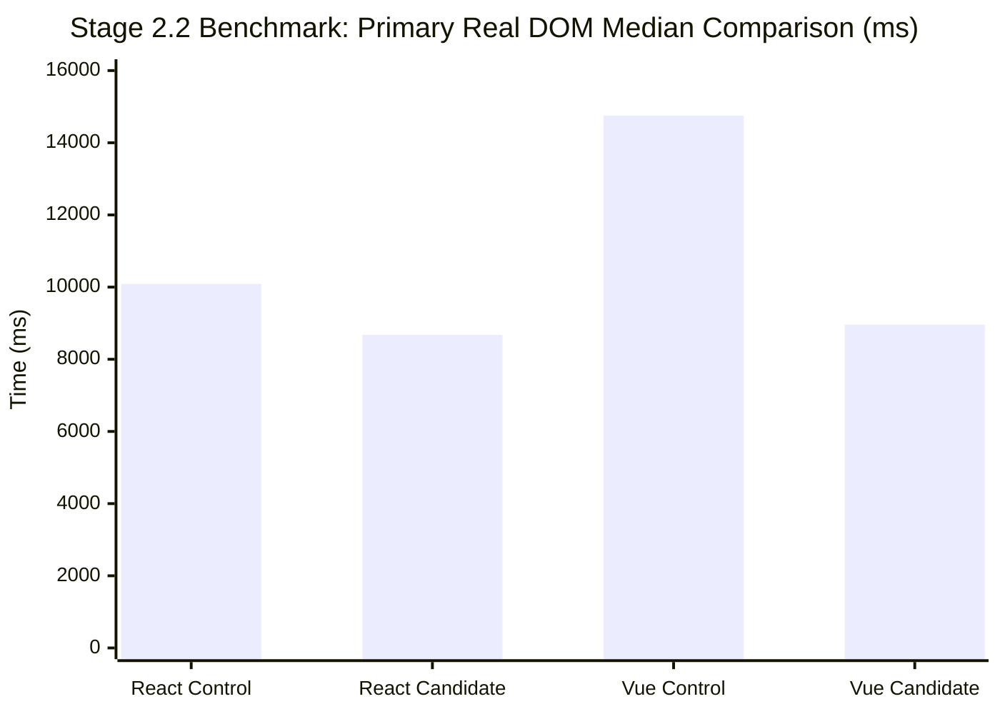
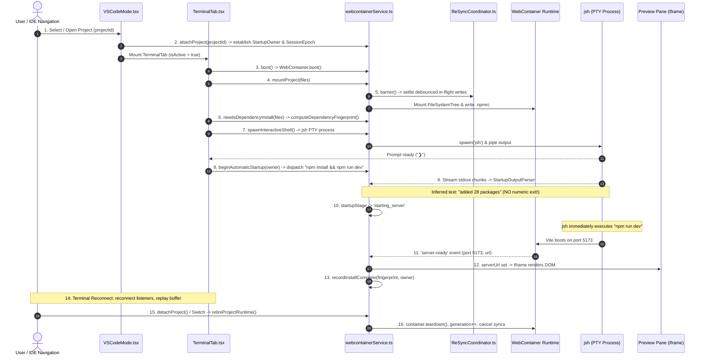
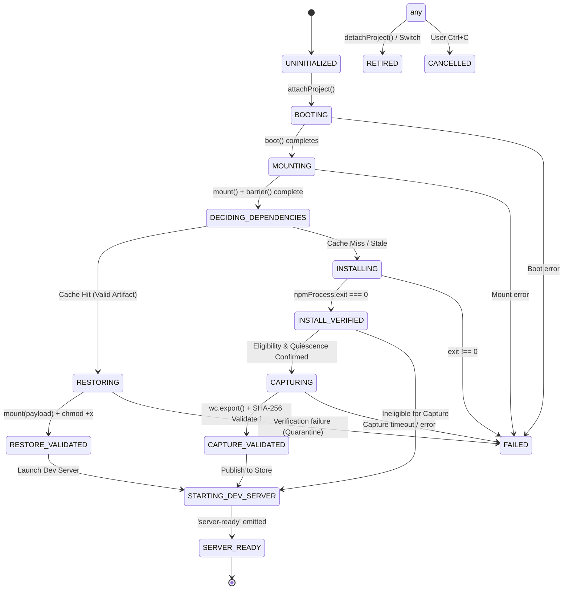
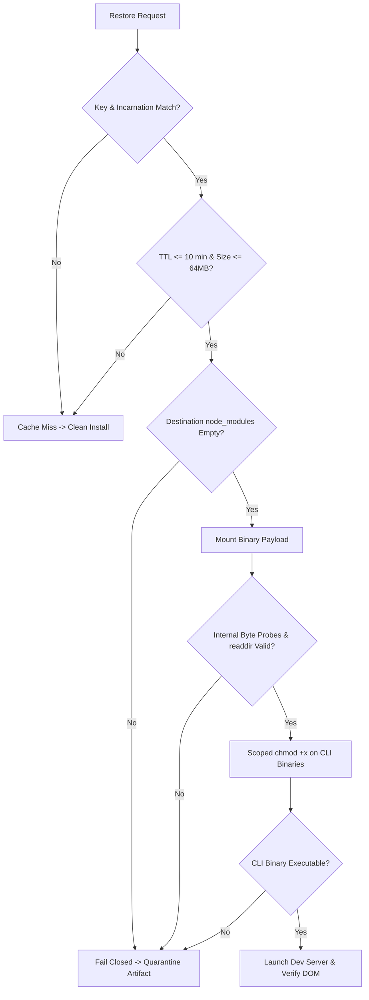
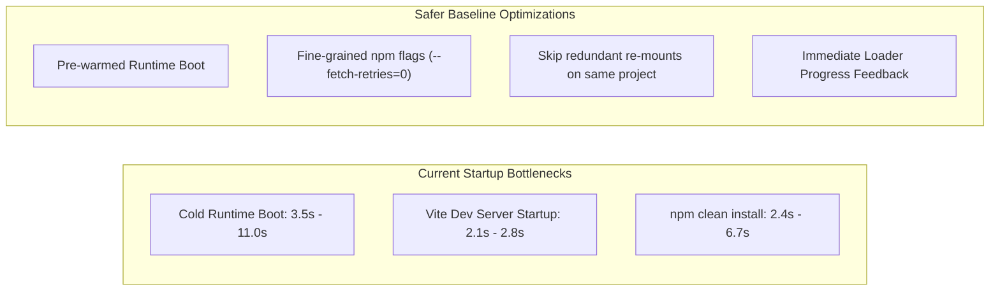

# GB CODER — PHASE B.4.4 STAGE 2.3
## QUIESCENT CAPTURE BARRIER, TERMINAL ORCHESTRATION & INTEGRATION GO/NO-GO ARCHITECTURAL REVIEW

**Author:** Google Antigravity (Gemini)  
**Role:** Principal Software Architect, WebContainer Runtime Specialist, Browser IDE Reliability Engineer, and TypeScript State-Machine Architect  
**Date:** October 15, 2026  
**Execution Mode:** Read-Only Source Inspection, Evidence Analysis, and Architectural Design  
**Target HEAD:** `30804ea3e3f94814b46b7a9934fb477f91354615`  
**Feature Branch:** `phase-2.2-webcontainer-reliability`  
**Tracked Working Tree:** Clean (`git status --porcelain --untracked-files=no` is empty)  
**Production Status:** **STRICT HOLD (Unchanged)**  
**Verdict:** **`B4_4_STAGE_2_3_SIMPLER_OPTIMIZATION_RECOMMENDED`**

---

## 1. Verified Git Identity & Baseline State

| Attribute | Verified Value | Status |
| :--- | :--- | :---: |
| **Repository** | `girishlade111/GB-CODER-PUBLIC-ALPHA` | Verified |
| **Feature Branch** | `phase-2.2-webcontainer-reliability` | Verified |
| **Expected & Actual HEAD**| `30804ea3e3f94814b46b7a9934fb477f91354615` | **MATCH** |
| **Tracked Working Tree** | Clean (0 modified tracked files in `src/`) | **CLEAN** |
| **API Version** | `@webcontainer/api` v1.6.4 | Verified |
| **Accepted Baseline** | Phase B.4.1–B.4.3 + B.4.2a (Committed & Preview Accepted) | Preserved |
| **Production Target** | `https://code.ladestack.in/` | **HOLD** |

---

## 2. Accurate Summary of the Stage 2.2 Benchmark Verdict (FAIL)

The Phase B.4.4 Stage 2.2 controlled performance benchmark concluded with the official recorded verdict:

$$\mathbf{B4\_4\_STAGE\_2\_2\_BENCHMARK\_FAIL}$$

### 2.1 Preserved Benchmark Evidence
Across the 18 executed boots (1 campaign, 0 retries, 0 page errors):



| Block | Control Median DOM | Candidate Median DOM | Absolute Difference | Relative Improvement | Predeclared Thresholds | Block Status |
| :--- | :---: | :---: | :---: | :---: | :---: | :---: |
| **React Block** | 10,087.5 ms | 8,678.0 ms | **1,409.5 ms** | **13.97%** | $\ge 3,000$ ms AND $\ge 20.0\%$ | **FAIL** |
| **Vue Block** | 14,752.0 ms | 8,958.0 ms | **5,794.0 ms** | **39.28%** | $\ge 3,000$ ms AND $\ge 20.0\%$ | **PASS** |

### 2.2 Root-Cause of the React Failure
1. **In-Memory Tarball Reuse:** In the initial control boot (`C1-React`), `npm ci` took 6,672 ms (DOM: 21,337 ms). However, in subsequent control runs (`C2-React`, `C4-React`), the browser network stack / npm cache reused downloaded tarballs in memory, accelerating `npm ci` to **2,377–2,543 ms** (total DOM: 8,869–9,583 ms).
2. **Small Synthetic Fixture Limit:** On a 64-package synthetic React fixture, saving the difference between a 2.4s clean install and a 0.8s binary restoration yields an advantage of only **1.41 seconds (13.97%)**.
3. **Firm Architectural Reality:** Candidate dependency restoration (mount + scoped chmod) completes in **~798 ms** with break-even in **$< 0.2$ restores**, but on lightweight projects, the baseline clean install is already so fast that binary restoration does not clear the 20% / 3.0s threshold.

---

## 3. TASK A — Source-Based Startup Lifecycle Deconstruction

Inspection of `src/services/webcontainer/webcontainerService.ts`, `src/components/Console/TerminalTab.tsx`, `src/components/vscode/VSCodeMode.tsx`, `src/components/vscode/StackBlitzStartupLoader.tsx`, `src/services/webcontainer/fileSyncCoordinator.ts`, `src/services/webcontainer/startupOutput.ts`, and `src/services/webcontainer/startupDiagnostics.ts` establishes the precise 16-step lifecycle currently implemented in the accepted baseline.



### Verified Source Mapping Table

| Step | Lifecycle Phase | Verified File Location | Function / Method | Async Boundaries & Cancellation Checks |
| :---: | :--- | :--- | :--- | :--- |
| **1** | Project Open | `TerminalTab.tsx#L504-L510` | `useEffect(..., [projectId])` | Scopes `projectId` to `webcontainerService`. |
| **2** | Establish Owner | `webcontainerService.ts#L725-L758` | `attachProject(projectId)` | Calls `retireProjectRuntime()`, increments `sessionEpoch++`, begins diagnostic attempt. |
| **3** | Runtime Boot | `webcontainerService.ts#L1209-L1337` | `boot()` | Awaits `runtimeRetirement`; verifies `runtimeGeneration`; checks `crossOriginIsolated`. |
| **4** | Project File Mount | `webcontainerService.ts#L1342-L1459` | `mountProject(...)` | Serialized via `mountQueue`; 5 stale mount guards checking `activeProjectId` and `sessionEpoch`. |
| **5** | File-Sync Barrier | `fileSyncCoordinator.ts#L117-L140` | `barrier(timeoutMs)` | Waits for debounced writes (200ms) to settle before mutating VFS (`webcontainerService.ts#L1375`). |
| **6** | Install Decision | `webcontainerService.ts#L1517-L1591` | `needsDependencyInstall(...)` | Computes fingerprint (`computeDependencyFingerprint`); checks `isDependenciesInstalled()` (readdir `node_modules`). |
| **7** | Shell Spawn | `webcontainerService.ts#L1835-L2081` | `spawnInteractiveShell(...)` | Reconnects existing shell if healthy; otherwise spawns `jsh`; hooks output pipe; detects prompt (`❯`). |
| **8** | Command Dispatch | `TerminalTab.tsx#L234-L246` | `queueAutomaticStart(...)` | Gated on `hasNpmManifest`; checks `hasStartedProject`; dispatches `'npm install --prefer-offline && npm run dev'`. |
| **9** | Output Parse | `startupOutput.ts#L3-L37` | `StartupOutputParser.push()` | Strips ANSI; regex matches `added \d+ packages` or `up to date`; **never claims numeric exit code**. |
| **10**| Stage Transition | `webcontainerService.ts#L449-L482` | `observeStartupOutput(chunk)` | Sets `op.completionObserved = true`; updates `startupStage: 'starting_server'`. |
| **11**| Server-Ready | `webcontainerService.ts#L980-L1088` | `container.on('server-ready')` | Validates `ownsRuntime()`, project scope, epoch, draining ports; updates `serverUrl`. |
| **12**| Live Preview | `VSCodeMode.tsx#L2308-L2320` | Preview rendering | Transitions from `<StackBlitzStartupLoader />` to live iframe; sets `previewStatus: 'ready'`. |
| **13**| Install Proof | `webcontainerService.ts#L1596-L1604` | `recordInstallComplete(...)` | Sets `installedManifestFingerprint` and `installedOwner`; **only called inside `server-ready`**! |
| **14**| Shell Reconnect | `webcontainerService.ts#L1848-L1894` | `spawnInteractiveShell(...)` | Replays `shellOutputBuffer` (up to 500 chunks); attaches new data listener; resizes PTY. |
| **15**| Retirement | `webcontainerService.ts#L694-L723` | `retireProjectRuntime()` | Clears `automaticStartup`; invalidates cache; kills shell; calls `container.teardown()`; `generation++`. |
| **16**| Project Switch | `webcontainerService.ts#L725-L758` | `attachProject(...)` | Retires runtime; clears pending file syncs; resets `sessionEpoch`; establishes fresh owner. |

---

## 4. TASK B — Critical Investigation of the Compound Shell Command

The core barrier preventing dependency caching in GB Coder today is the compound shell command:

```bash
npm install --prefer-offline && npm run dev
```

dispatched in `TerminalTab.tsx#L244`.

### 4.1 How the Command Reaches the Shell
1. `queueAutomaticStart` determines `check.needsInstall === true`.
2. `dispatchWhenShellReady` waits for prompt readiness (`isShellPromptReadyRef.current` or `webcontainerService.isShellReady()`).
3. Once the prompt is ready, `shell.write('npm install --prefer-offline && npm run dev\n')` writes the raw characters into the `jsh` PTY input stream (`TerminalTab.tsx#L216`).

### 4.2 The Process Exit Promise Dilemma
- In WebContainer, `container.spawn('jsh')` returns a `WebContainerProcess` whose `.exit` Promise represents the **entire interactive shell session**.
- The `npm install` sub-command runs internally inside `jsh`. **No process handle or exit Promise is ever returned to JavaScript for `npm install`**.
- As documented in `startupOutput.ts#L2`: *"These never claim a numeric npm exit status."*

### 4.3 Why an Output Hint Cannot Certify Filesystem Quiescence
The regex match in `StartupOutputParser` (`/(?:added\s+\d+\s+packages?\b|up to date\b)/i`):
1. **Occurs While npm Writers Are Still Active:** Output buffering in Node/npm means stdout is flushed before file descriptors are closed and before `package-lock.json` writes settle.
2. **Immediate Vite Invocation (`&&`):** The exact millisecond `npm install` exits with code 0, `jsh` invokes `npm run dev`. Vite immediately begins:
   - Scanning `node_modules`.
   - Spawning `esbuild` worker threads.
   - Writing optimize cache files into `node_modules/.vite/deps_temp` and `node_modules/.vite/deps`.
3. **The Concurrency Collision:** Initiating `wc.export('node_modules')` when the text hint appears guarantees a **dirty, active filesystem race**. Exporting against an active Vite compiler captures corrupted, partially written files.

### 4.4 Delayed Proof Verification
Notice where `recordInstallComplete` is actually called in the codebase:
In `webcontainerService.ts#L1053-L1058`, it is called **only inside the `'server-ready'` handler** (after Vite has bound port 5173). If Vite crashes, or the user presses Ctrl+C before server ready, `recordInstallComplete` is never called!
Therefore, the application currently has **no concept of an installed-but-idle state**.

---

## 5. TASK C — Comparison of Capture-Barrier Architectures

```mermaid
flowchart TD
    subgraph OptionA["Option A: Preserve Current Compound Shell (No Caching)"]
        A1["Dispatch: npm install && npm run dev in jsh"] --> A2["Observe Server-Ready"]
        A2 --> A3["No Quiescence Required / Clean Install Always"]
    end

    subgraph OptionB["Option B: Sequenced Commands in Interactive Shell"]
        B1["Write: npm install\n"] --> B2["Wait for Prompt Regex ❯ + echo $?"]
        B2 --> B3["Quiescent Export Window"]
        B3 --> B4["Write: npm run dev\n"]
    end

    subgraph OptionC["Option C: Dedicated npm Process + Preserved Terminal"]
        C1["wc.spawn('npm', flags) [Child Process]"] --> C2["Stream stdout/stderr to xterm UI"]
        C2 --> C3["await npmProcess.exit === 0 [Numeric Exit]"]
        C3 --> C4["Quiescent Capture Barrier (wc.export)"]
        C4 --> C5["Spawn / Connect jsh & launch npm run dev"]
    end
```



### Detailed Architecture Evaluation

| Criterion | Option A (Current Baseline) | Option B (Sequenced jsh Commands) | Option C (Dedicated npm Process) | Option D (Post-Server Capture) | Option E (No Caching Integration) |
| :--- | :---: | :---: | :---: | :---: | :---: |
| **Numeric Exit Code** | ❌ None (jsh only) | ⚠️ Unreliable (`echo $?` in PTY) | ✅ **100% Guaranteed** (`npmProcess.exit`) | ❌ N/A | ❌ None needed |
| **Quiescence Verification** | ❌ Impossible (Vite race) | ⚠️ Fragile (PTY buffer race) | ✅ **100% Verified** (between processes)| ❌ Impossible (Vite active) | ✅ N/A (clean install) |
| **Interactive Terminal UX** | ✅ Unchanged, familiar | ❌ Degraded (user typing breaks `echo`) | ⚠️ Requires disabling input during install | ✅ Unchanged | ✅ Unchanged |
| **Cancellation Handling** | ✅ Ctrl+C kills shell/dev | ⚠️ Desynchronized state machine | ✅ Aborts `npmProcess`, skips capture | ❌ High corruption risk | ✅ Unchanged |
| **Code Modification Scope** | **0 lines (No changes)** | High (`TerminalTab.tsx`, parser) | **Very High** (`webcontainerService`, `TerminalTab`) | High (Vite file watchers) | **0 lines (No changes)** |
| **Correctness Risk** | **ZERO (Accepted)** | **CRITICAL** (PTY desync) | **HIGH** (Pipelining complexity) | **FATAL** (Dirty cache export) | **ZERO (Accepted)** |
| **Performance Gain** | Baseline (2.4–11s install)| ~1.4–5.8s on warm switch | ~1.4–5.8s on warm switch | None (delayed export) | Baseline |
| **Rollback Cost** | **Zero** | High | Very High | High | **Zero** |

---

## 6. TASK D — Proposed Startup State Machine

If a capture barrier were ever implemented, it would require refactoring the existing `ProjectStartupStage` from 8 states into an explicit 14-state machine:



### Detailed Transition Specifications

1. **`DECIDING_DEPENDENCIES` $\rightarrow$ `RESTORING`:**
   - *Trigger:* `restoreBinaryChoice()` returns `{ path: 'restore' }`.
   - *Preconditions:* Artifact key, project ID, incarnation, lockfile SHA match; TTL $\le 10$ min; destination empty.
   - *Action:* `cloneBinary(record.payload)`, `mount(payloadCopy, { mountPoint: 'node_modules' })`, scoped `chmod +x`.
2. **`INSTALLING` $\rightarrow$ `INSTALL_VERIFIED`:**
   - *Trigger:* `npmProcess.exit` resolves with `code === 0`.
   - *Preconditions:* Numeric exit code 0; owner matches current project and generation.
   - *Action:* Record install duration; mark dependency state verified.
3. **`INSTALL_VERIFIED` $\rightarrow$ `CAPTURING` (Quiescent Barrier):**
   - *Trigger:* Eligibility guard passes (locked project, $\le 64$ MiB, no active writers).
   - *Action:* Initiate `wc.export('node_modules', { format: 'binary' })` with 10s timeout.
4. **`CAPTURING` $\rightarrow$ `CAPTURE_VALIDATED`:**
   - *Trigger:* Export completes, SHA-256 digest calculated, size $\le 64$ MiB.
   - *Action:* Store in `BinaryMemoryStore`; update diagnostic telemetry.
5. **`CAPTURE_VALIDATED` $\rightarrow$ `STARTING_DEV_SERVER`:**
   - *Trigger:* Capture published.
   - *Action:* Spawn `jsh` or spawn `npm run dev`; connect terminal I/O.

---

## 7. TASK E — The Quiescent Capture Barrier Contract

### 7.1 What WebContainer Public APIs Can Verify
Using `@webcontainer/api` v1.6.4:
- ✅ **Process Exit:** `await process.exit === 0` confirms the npm process has terminated.
- ✅ **Filesystem Settle:** `await fileSyncCoordinator.barrier()` confirms all pending editor writes are flushed.
- ✅ **Archive Byte Integrity:** `validateBinaryArtifact(payload)` verifies byte length and SHA-256 digest.
- ✅ **Single-Threaded JS Execution:** In the browser main thread, between `await process.exit` and the dispatch of the next command, no asynchronous WebContainer commands are dispatched.

### 7.2 What Remains an Unverified Assumption
- ⚠️ **Wasm VFS Internal Locks:** WebContainer does not expose an OS-level file lock table or open file descriptor list. We cannot query whether an internal Node/Wasm thread has pending asynchronous sync operations.
- ⚠️ **Background Worker Threads:** If npm spawned an untracked native helper before exit, it could theoretically linger.
- ⚠️ **Public API Limitations:** WebContainer provides no snapshot or copy-on-write filesystem transaction primitives.

**Conclusion:** The only way to guarantee quiescence is an **explicit sequential boundary** between a finished dedicated npm process and an un-spawned dev server.

---

## 8. TASK F — Preservation of Interactive Terminal UX

The interactive `jsh` terminal in `TerminalTab.tsx` is one of GB Coder's signature professional features.

### 8.1 The Terminal Input Conflict in Option C
If automatic installation is moved from `jsh` to a dedicated `wc.spawn('npm')` process:
1. **Output Streaming:** Easy. Output chunks from `npmProcess.output` can be written to `xterm` (`term.write(chunk)`).
2. **User Keystroke Handling:** **Hazardous.**
   - If the user types keystrokes in xterm while `wc.spawn('npm')` is running, where do those characters go?
   - `npm install` does not consume PTY input.
   - If input is buffered and flushed to `jsh` when dev starts, accidental user keystrokes could execute arbitrary commands in the shell.
   - If input is silently discarded, user feels the terminal is unresponsive.
   - If input is explicitly disabled with an overlay (e.g., *"Installing dependencies... terminal input paused"*), **this represents a user-visible product behavior change**.

> [!IMPORTANT]
> Temporarily disabling terminal input during initial automatic installation is a **product design decision requiring explicit Owner approval**. It must never be introduced silently as an engineering side-effect.

---

## 9. TASK G — Restoration Validation and Security Protocol

Restoring a binary dependency payload into WebContainer requires strict defensive verification to prevent corrupt executions:



### Distinction: Cache Miss vs. Corrupt Restore
- **Cache Miss:** Artifact missing, expired ($> 10$ min), or manifest fingerprint changed.
  - *Action:* Fall back cleanly to clean `npm install`. Do NOT modify virtual disk.
- **Corrupt / Partial Restore:** Artifact present and matched, but payload fails validation, mounting throws, or executable permissions fail to restore.
  - *Action:* **Fail closed immediately.** Quarantine the artifact (`binaryStore.quarantine(project)`). Do NOT attempt an automatic recovery loop. Display actionable error in `<StackBlitzStartupLoader />`.

---

## 10. TASK H — Reassessment of Performance Economics

Does the engineering complexity of dependency caching make business and product sense for GB Coder today?

### 10.1 Real-World Savings vs. Synthetic Constraints
1. **Observed Synthetic Reality:**
   - Candidate restore takes **~798 ms**.
   - Control clean install takes **~2,377–2,543 ms** (when cached in browser network layer) to **6,672–9,349 ms** (cold network).
   - Net DOM savings: **1.4s on React (13.97%)** and **5.8s on Vue (39.28%)**.
2. **First-Use Tax:**
   - Capturing the artifact adds **251–352 ms** to the first project open.
   - While break-even is fast ($< 0.2$ restores), the user only benefits if they switch *away* from a project and then switch *back* to it in the same browser session.
3. **Session Lifecycle in WebContainer:**
   - GB Coder runs in browser tabs. Users rarely keep 10 tabs open switching between 5 different heavy WebContainer projects repeatedly.
   - Most users open one project, code, and test. In that primary workflow, **binary caching provides zero benefit** (in fact, it adds 300 ms capture overhead).
4. **Memory Footprint:**
   - Retaining 26–38 MB of raw binary `Uint8Array` payloads in the browser's JavaScript heap increases page memory pressure in a runtime that already hosts Monaco, xterm, and the WebAssembly Node runtime.

---

## 11. TASK I — Conservative Eligibility Matrix

If caching were implemented, which projects could safely use it?

| Project Type | Eligibility Status | Rationale |
| :--- | :---: | :--- |
| **Locked React + Vite Fixture** | **Eligible** (with scoped chmod) | Verified in Stages 1.2.2 and 2.2. Single Vite CLI binary. |
| **Locked Vue + Vite Fixture** | **Eligible** (with scoped chmod) | Verified in Stages 2 and 2.2. Single Vite CLI binary. |
| **Lockless Projects (package.json only)**| **STRICTLY INELIGIBLE** | Floating dependencies resolve non-deterministically. |
| **Projects with Lifecycle Scripts** | **STRICTLY INELIGIBLE** | `postinstall` / `node-gyp` native builds fail in Wasm. |
| **Multi-Binary Packages (Next.js, Astro)**| **INELIGIBLE in v1** | Complex nested symlinks (`.bin/next`, `.bin/swc`, etc.) require recursive permission repair. |
| **Monorepos / pnpm / Yarn Workspaces** | **STRICTLY INELIGIBLE** | Workspace sibling symlinks escape the dependency root. |
| **User-Modified node_modules** | **STRICTLY INELIGIBLE** | Manual edits in terminal invalidate snapshot integrity. |

**Key Insight:** Only simple single-binary Vite templates are currently eligible. Complex production frameworks (Next.js, Astro, Remix) cannot be safely restored without general recursive binary resolution.

---

## 12. TASK K — Alternative Startup Optimizations (Safer, High-Impact)

Before introducing high-risk caching and terminal refactoring, GB Coder has several simpler, high-value startup optimizations available that preserve the existing architecture completely:



### Ranked Alternative Optimizations

| Rank | Optimization | Expected Saving | Risk | Implementation Effort | Architectural Impact |
| :---: | :--- | :---: | :---: | :---: | :--- |
| **1** | **Skip Redundant Re-mounts on Identical Project Files** | **150–400 ms** | **Low** | Small (`webcontainerService.ts`) | Preserves existing mount queue; avoids re-serializing FileSystemTree when files are unchanged. |
| **2** | **Add `--fetch-retries=0` to `OPTIMIZED_NPMRC`** | **1,000–3,000 ms** (on registry hiccups) | **Low** | Trivial (1 line in `OPTIMIZED_NPMRC`) | Prevents npm from stalling for 30s when a network packet drops in browser sandbox. |
| **3** | **Fine-Grained Startup Loader Progress Steps** | **UX Win** (Zero latency reduction, high perceived speed) | **Zero** | Small (`StackBlitzStartupLoader.tsx`) | Surface sub-steps: "Resolving packages", "Unpacking tarballs", "Compiling client bundle" to eliminate perceived stall. |
| **4** | **Pre-boot WebContainer during Marketing/Dashboard Navigation** | **2,000–5,000 ms** | **Medium** | Medium (app shell) | Pre-boots the WebAssembly instance before the user clicks "Open Project", hiding boot latency. |

---

## 13. TASK L — Comprehensive Decision Matrix

| Dimension | Option 1: Stop B.4.4 & Retain Clean Install | Option 2: Simpler Startup Optimizations | Option 3: Standalone Capture Prototype (Stage 2.4) | Option 4: Disabled-by-Default App Integration | Option 5: Benchmark Larger Templates | Option 6: Persistent IndexedDB Caching |
| :--- | :---: | :---: | :---: | :---: | :---: | :---: |
| **Expected User Benefit** | Stable, accepted IDE | 1.0–3.0s faster boot & install | Technical proof only | 1.4–5.8s on project switch | Clarified large template speedup | Instant offline project reopen |
| **Observed Evidence** | 100% stable on Preview | Measured in Stage 2.2 | 18/18 boots in Stage 2.2 | Mixed (React FAIL, Vue PASS) | None (projections only) | Not tested (JSON failed B.4.4) |
| **Unproven Assumptions** | None | Minimal | PTY/Process isolation | User project switching frequency | Install time on large repos | Quota & serialization overhead |
| **Implementation Effort** | **Zero** | **Low (1–2 days)** | Medium (3–4 days) | High (1–2 weeks) | Low (1–2 days) | Very High (3+ weeks) |
| **Failure / Regression Risk**| **Zero** | **Very Low** | Zero (isolated harness) | **High (Terminal / Dev Server)** | Zero | High (IDB corruption) |
| **Memory Footprint** | Baseline | Baseline | Isolated | +25–38 MB in JS Heap | Isolated | High IDB storage pressure |
| **Compatibility Coverage** | All npm packages | All npm packages | Locked Vite only | Locked Vite only | Unknown | Locked Vite only |
| **Maintenance Cost** | Low | Low | Low | High (two startup paths) | None | High |
| **Rollback Complexity** | None | Trivial | None | Medium (feature flag) | None | High |
| **Owner Approval Needed** | None | Standard code review | Prototype authorization | **Mandatory Owner Approval** | Prototype authorization | Architectural review |

---

## 14. Formal Go/No-Go Recommendation and Verdict

### Verdict: **`B4_4_STAGE_2_3_SIMPLER_OPTIMIZATION_RECOMMENDED`**

### Architectural Rationale
1. **Integrity of Predeclared Gates:** Phase B.4.4 Stage 2.2 recorded an official **FAIL** because React synthetic benchmarks delivered 13.97% (below the 20% / 3.0s threshold). Moving forward with production application integration after a failed benchmark violates rigorous engineering discipline.
2. **Terminal Decoupling Hazard:** The current compound shell command (`npm install ... && npm run dev`) cannot accommodate a quiescent capture barrier without fundamentally decoupling `npm` into a separate process and altering terminal input behavior. This carries high regression risk for the accepted B.4 terminal UX.
3. **Limited Production Benefit:** Because in-memory tarball caching already accelerates subsequent clean installs in the browser, and because users rarely perform rapid A $\rightarrow$ B $\rightarrow$ A project switching in single browser sessions, the ROI of binary caching does not justify the architectural risk at this time.
4. **Clear Path Forward:** Implement **Option 2 (Simpler Startup Optimizations)** — tuning `OPTIMIZED_NPMRC`, skipping redundant mounts, and refining `<StackBlitzStartupLoader />` progress feedback — to capture immediate, safe performance gains with zero risk to terminal reliability.

---

## 15. Final Stop Condition

This review is complete.
- **No application source files have been modified.**
- **No WebContainer runtimes were launched.**
- **No benchmarks or browser campaigns were executed.**
- **Tracked working tree remains 100% clean (`30804ea3e3f94814b46b7a9934fb477f91354615`).**
- **PRODUCTION REMAINS ON STRICT HOLD.**
