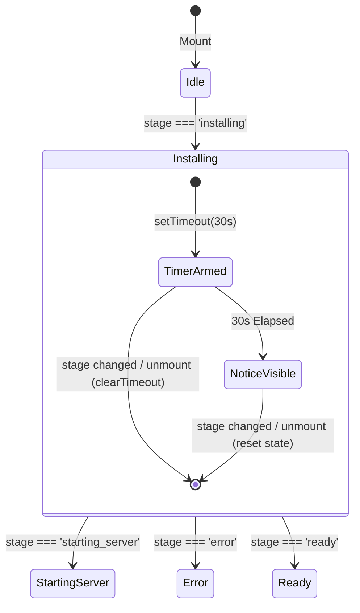

# GB CODER — PHASE B.5.2
## TRUTHFUL STARTUP LOADER & EVENT-DRIVEN PROGRESS — IMPLEMENTATION DESIGN REPORT

**Author:** Google Antigravity (Gemini)  
**Role:** Principal React/TypeScript Engineer, Browser IDE UX Architect, and WebContainer Startup Reliability Specialist  
**Date:** October 15, 2026  
**Execution Mode:** Read-Only Source Analysis, UI/Data-Flow Design, and Scoped Implementation Planning  
**Target HEAD:** `8fff6a2fc67e698b4882884bbdbd3ea004ccfb31`  
**Parent HEAD:** `30804ea3e3f94814b46b7a9934fb477f91354615`  
**Feature Branch:** `phase-2.2-webcontainer-reliability`  
**Tracked Working Tree:** Clean (`git status --porcelain -uno` is empty)  
**Production Status:** **STRICT HOLD (Unchanged)**  
**Official Verdict:** **`B5_2_UI_ONLY_IMPLEMENTATION_RECOMMENDED`**

---

## 1. Verified Repository Identity & Baseline State

| Attribute | Verified Value | Status |
| :--- | :--- | :---: |
| **Repository** | `girishlade111/GB-CODER-PUBLIC-ALPHA` | Verified |
| **Feature Branch** | `phase-2.2-webcontainer-reliability` | Verified |
| **Current Local HEAD** | `8fff6a2fc67e698b4882884bbdbd3ea004ccfb31` | **MATCH** |
| **Parent Commit** | `30804ea3e3f94814b46b7a9934fb477f91354615` (B.4 Baseline) | **MATCH** |
| **Tracked Working Tree** | Clean (`git status --porcelain -uno` returns 0 lines) | **CLEAN** |
| **B.5.1 Commit Scope** | `src/components/vscode/VSCodeMode.tsx` + `scripts/test-phase-b5-1-restart-mount.mjs` | Verified |
| **B.4.4 Research Posture** | Formally Closed; Binary Dependency Reuse Deferred | Upheld |
| **Production Posture** | `https://code.ladestack.in/` | **STRICT HOLD** |
| **Preview Posture** | `https://gb-coder-public-alpha-6l37qqpda.vercel.app` (B.4 Preview) | Upheld |

---

## 2. Current Startup Loader Architecture

### 2.1 Component Role & Placement
`StackBlitzStartupLoader.tsx` (`src/components/vscode/StackBlitzStartupLoader.tsx`) is the primary transition component displayed in the Advanced IDE's right panel (`VSCodeMode.tsx#L2300-L2315`) when a project is opening or restarting and no dev server URL is yet live (`!activePreview.url`).

```
+---------------------------------------------------------------------------------------+
|  VSCodeMode Layout                                                                    |
|  +--------------------+----------------------------------+-------------------------+  |
|  | Activity Bar       | Editor / Explorer / Terminal     | Right Panel             |  |
|  |                    |                                  |                         |  |
|  |                    |                                  | [ If activePreview.url ]|  |
|  |                    |                                  |  -> <iframe src=url />  |  |
|  |                    |                                  |                         |  |
|  |                    |                                  | [ Else ]                |  |
|  |                    |                                  |  -> <StartupLoader />   |  |
|  +--------------------+----------------------------------+-------------------------+  |
|  Status Bar: WebContainer: [startupStage] | Dev Server Port                          |  |
+---------------------------------------------------------------------------------------+
```

### 2.2 Component Interface
The loader currently accepts the following props:
```typescript
interface StackBlitzStartupLoaderProps {
  stage: ProjectStartupStage;
  serverPort?: number | null;
  runtimeError?: WebContainerRuntimeError | null;
  onOpenTerminal?: () => void;
  onRestart?: () => void;
  onRetryInstall?: () => void;
  operationPending?: boolean;
}
```

### 2.3 Visual Hierarchy & Presentation Elements
1. **Pulsing Lightbulb Graphic (`L77-L104`):** SVG outline with glowing cyan (or rose in error state) filter and a lightning-bolt filament.
2. **Main Headline (`L107-L119`):** Dynamic string driven by stage (`'Starting WebContainer'`, `'Mounting Project Files'`, `'Installing Dependencies'`, `'Starting Development Server'`, `'Development Server Ready'`, `'Setup Encountered an Error'`).
3. **Explaining Subtext (`L121-L133`):** Stage-specific commentary.
4. **Step Checklist Box (`L136-L238`):** 4 discrete IDE startup steps with state icons (`Circle`, `Loader2` animate-spin, `CheckCircle2`, `AlertCircle`):
   - Step 1: `Booting WebContainer`
   - Step 2: `Mounting project files`
   - Step 3: `Installing dependencies`
   - Step 4: `Starting development server`
5. **Action Controls (`L241-L281`):** Action buttons rendered conditionally:
   - `Retry Installation` (if `isError && errorPhase === 'install'`)
   - `Restart Process` / `Restart Dev Server`
   - `View Live Terminal`

---

## 3. Verified Startup Stage & Event Mapping (Task A)

GB Coder manages startup stages through `ProjectStartupStage` in `src/services/webcontainer/webcontainerService.ts`:

```typescript
export type ProjectStartupStage =
  | 'idle'
  | 'booting'
  | 'mounting_files'
  | 'runtime_ready'
  | 'installing'
  | 'starting_server'
  | 'ready'
  | 'error';
```

### Stage Investigation Matrix

| Stage | Actual Trigger & Source Function | Source of Truth | Diagnostic Metadata | Ownership Guard | Cancellation & Retirement | Safe User Explanation | What Remains Unknown |
| :--- | :--- | :--- | :--- | :--- | :--- | :--- | :--- |
| **`idle`** | Constructor (`L523`), `resetProjectStartState` (`L752`), `retireProjectRuntime` (`L780`), or process exit (`L1996`). | `webcontainerService.state.startupStage` | None | Reset on epoch/generation mismatch | Cleans up watchdogs and active startup records | "Environment idle / ready for action" | Whether user will open a new project or reconnect |
| **`booting`** | `TerminalTab.tsx#L269` (`setStartupStage('booting')`) & `webcontainerService.ts#L1259` (`boot()`). | `webcontainerService.state.startupStage` | `webcontainerPerf` timer (`boot`) | `runtimeGeneration`, singleton boot promise | Tear down container via `wc.teardown()` on retirement | "Initializing the browser-based development environment..." | Exact browser Wasm compile & init duration (varies 300ms–11s) |
| **`mounting_files`** | `webcontainerService.ts#L1372` inside `mountProject()`. | `webcontainerService.state.startupStage` | `webcontainerPerf` timer (`mount`) | `mountQueue`, `sessionEpoch` | Aborted if epoch or generation changes | "Syncing source files to virtual filesystem..." | Exact virtual inode write duration (typically 50–350ms) |
| **`runtime_ready`** | *Dead stage variant*. Defined in type but never emitted by any runtime function. | N/A | None | N/A | N/A | N/A (Do not show) | Deprecated internal variant |
| **`installing`** | `webcontainerService.ts#L393` in `beginAutomaticStartup(..., needsInstall=true)` or `requestRestart` (`L675`). | `webcontainerService.state.startupStage` | `StartupDiagnostics.record('install', 'started')` | `isStartupOwner(owner)`, 240s watchdog | Watchdog cancellation; Ctrl+C in terminal | "Installing project dependencies..." | Remaining package download bytes, network latency, individual package completion |
| **`starting_server`** | a) `beginAutomaticStartup` when `needsInstall=false` (`L393`); b) `observeStartupOutput` on install completion hint (`L480`). | `webcontainerService.state.startupStage` | `StartupDiagnostics.record('server', 'started')` | `isStartupOwner(owner)` | Watchdog cancellation; Ctrl+C in terminal | "Launching development server inside WebContainer..." | Port binding delay, Vite plugin transform time |
| **`ready`** | `webcontainerService.ts#L1077, L1132` upon WebContainer `'server-ready'` event emission. | `webcontainerService.state.serverUrl !== null` | `serverPort`, `serverUrl`, `StartupDiagnostics.finish('succeeded')` | Verified `ownsRuntime()` and matching epoch | Dropped if port belongs to drained/retired session | "Server is live and listening on port [port]" | How fast the user's specific web app hydrates in iframe |
| **`error`** | `setStartupStage('error', runtimeError)` called on COOP/COEP lack, boot throw, mount fail, install fail, or watchdog timeout. | `webcontainerService.state.runtimeError` | `WebContainerRuntimeError` (`phase`, `message`, `details`) | Scoped to active attempt | Halts automatic startup; keeps terminal accessible | Exact error message from runtime or diagnostic | Whether external network will recover immediately on retry |

### Ground-Truth Categories
1. **Verified Runtime Events:**
   - WebContainer singleton instantiation (`WebContainer.boot()`).
   - Filesystem tree write settlement (`container.mount(tree)`).
   - Server port binding (`container.on('server-ready', ...)`).
   - Shell process termination (`process.exit`).
2. **Inferred Terminal-Output Hints:**
   - Regex detection of `/(?:^|[\r\n])\s*(?:added\s+\d+\s+packages?\b|up to date\b)/i` indicating npm has finished writing.
   - Regex detection of `/npm\s+(?:ERR!|error\b)|\bcode\s+(?:ERESOLVE|ENOENT|ECONNRESET|ENOTFOUND|ETIMEDOUT)\b/i`.
   - *These are hints, not exit codes.* `jsh` runs `npm install && npm run dev` continuously; npm has no separate process exit code.
3. **Elapsed-Time State:**
   - Watchdog timer (240 seconds).
   - Duration timers in `webcontainerPerf`.

---

## 4. Terminal-Output Hint Limitations & Micro-Progress Boundaries (Task B)

### 4.1 Suppressed Terminal Output in `.npmrc`
In `src/services/webcontainer/webcontainerService.ts#L27-L35`, WebContainer enforces:
```ini
legacy-peer-deps=true
audit=false
fund=false
prefer-offline=true
progress=false
update-notifier=false
```
`progress=false` is intentionally set to eliminate heavy ANSI cursor recalculations in the browser's xterm PTY. Consequently, npm **does not emit percentage progress bars or fine-grained status chunks**.

### 4.2 Limitations of Interactive PTY Streaming
1. **Compound Shell Command:** TerminalTab dispatches `'npm install --prefer-offline && npm run dev'` as a single string into `jsh`.
2. **No Numeric npm Exit Code:** The shell does not yield a separate exit code for `npm install`. Vite is started in the same shell process if npm exits with 0.
3. **Chunk Boundary Fragmentation:** Terminal text chunks arrive unpredictably (from 1 byte to several kilobytes) depending on browser frame scheduling and event loop load.
4. **False Inferences:** Attempting to infer sub-phases (e.g., "Resolving packages", "Downloading dependencies", "Extracting") via regex matching over raw chunks is fragile, causes visual flicker, and risks false claims (especially when npm uses the browser HTTP cache or local offline tarballs).

### 4.3 Policy on Micro-Progress
- **Prohibited:** Fabricated progress bars, estimated percentages (e.g., "47% complete"), and synthetic countdown timers.
- **Allowed & Recommended:** Clear, neutral descriptive messaging:
  - Header: `"Installing Dependencies"`
  - Description: `"Installing project dependencies. This may take longer for initial or large project setups."`
  - Checklist item: Active spinner on `"Installing dependencies"`.
  - Non-blocking guidance: Direct user to live terminal output if prolonged.

---

## 5. Slow-Install Notice Design (Task C)

During cold dependency installations or slower network connections, dependency installation may take 30–60 seconds. A static spinner without feedback can cause users to suspect the IDE has frozen or failed.

### 5.1 Design Specifications
1. **Threshold:** 30 seconds of continuous `stage === 'installing'`.
2. **Activation Rule:** The notice displays **only** when `stage === 'installing'` continuously exceeds 30,000 ms.
3. **Deactivation & Cancellation:**
   - Any stage transition (`starting_server`, `ready`, `error`, `idle`, `booting`) immediately clears the timer and hides the notice.
   - Component unmounting immediately clears the timer via standard React cleanup.
   - Project switching resets stage to `idle`/`booting`, guaranteeing no stale notice leaks across projects.
4. **Non-Blocking Informational Copy:**
   > *"Dependency installation is taking longer than usual. You can open the terminal to view live output."*
5. **No Negative Side-Effects:**
   - Does NOT imply the install has failed or hung.
   - Does NOT trigger automatic retries.
   - Does NOT dispatch WebContainer commands.
   - Does NOT spam repeated toasts or notifications.
6. **Self-Contained Implementation:**
   - Implemented entirely inside `StackBlitzStartupLoader.tsx` with local React state (`useState` + `useEffect`).
   - Requires zero changes to `webcontainerService.ts` or global state.



---

## 6. Audit of Inaccurate & Misleading Loader Copy (Task D)

A comprehensive audit of all user-facing strings in `StackBlitzStartupLoader.tsx` identified several areas for accuracy improvement:

| Line Number | Existing String | Technical Assessment | Recommended Replacement | Rationale |
| :---: | :--- | :--- | :--- | :--- |
| **L132** | `"Booting WebAssembly Node.js runtime with zero cloud latency..."` | **Misleading.** While Node.js runs locally via Wasm, WebContainer binaries and npm packages still require network transport and browser HTTP requests. "Zero cloud latency" is inaccurate marketing language. | `"Initializing the browser-based development environment..."` | Factual, professional, and truthfully describes local browser runtime initialization without false latency claims. |
| **L127** | `"Launching Vite dev server inside WebContainer..."` | **Overly Specific.** While current templates use Vite, GB Coder projects can also use other development servers or custom scripts. | `"Launching development server inside WebContainer..."` | Framework-agnostic and universally accurate for any project template. |
| **L129** | `"Installing project dependencies..."` | **Incomplete Context.** Does not set expectations for initial cold installs. | `"Installing project dependencies. This may take longer for initial setups..."` | Reassures the user without speculating on specific timing. |
| **L45, L50, L58** | `step1Done = !isBooting && !(isError && errorPhase === 'boot')` | **Logic Flaw on `idle`.** When `stage === 'idle'` (before startup begins), `!isBooting` evaluates to `true`, displaying Step 1 as completed with a green checkmark before boot has even occurred. | Guard with `stage !== 'idle'`: `step1Done = stage !== 'idle' && !isBooting && ...` | Prevents premature success checkmarks from flashing before the runtime starts. |

---

## 7. Preservation of Visual Design & Professional Theme (Task E)

The existing Advanced IDE dark theme is preserved without regression:
1. **Background & Layout:** Dark `#13141f` canvas, centered flex container, matching Monaco and terminal styling.
2. **Card Container:** `#181926]/90` backdrop with `border-white/10` and `backdrop-blur-sm`.
3. **Icons & Animation:**
   - Glowing lightbulb graphic with lightning bolt filament retained.
   - Lucide icons (`CheckCircle2`, `Circle`, `Loader2`, `TerminalSquare`, `RotateCcw`, `AlertCircle`) retained.
4. **Action Buttons:**
   - Secondary button: `border-white/10 bg-[#1e2030] text-slate-300 hover:bg-[#282a3f]`.
   - Error restart button: `border-amber-500/30 bg-amber-950/60 text-amber-300`.
   - Retry install button: `border-cyan-500/30 bg-cyan-950/60 text-cyan-300`.
5. **Slow-Install Notice UI:**
   - Subtle, non-blocking notification box inside the card:
     `border border-amber-500/20 bg-amber-500/10 text-amber-200 text-xs rounded-lg p-2.5`.
   - Includes embedded `Open Terminal` link/button styled consistently with the IDE.

---

## 8. React Lifecycle & Cancellation Safeguards (Task F)

| Lifecycle Event | Potential Risk | Architectural Safeguard |
| :--- | :--- | :--- |
| **Initial Mounting** | Timer initialized incorrectly | `useEffect` checks `if (stage !== 'installing') return;` |
| **React 18 StrictMode** | Double-mounting creates duplicate timers | Cleanup function in `useEffect` executes `clearTimeout(timer)`, ensuring exactly one timer survives. |
| **Stage Transition before 30s** | Stale timer fires after install finishes | Any change to `stage` triggers effect cleanup, clearing the timer. |
| **Project Switch** | Notice from Project A leaks into Project B | Stage transitions to `idle` or `booting` on project switch, resetting `isSlowInstall` to `false` and clearing timers. |
| **Component Unmount** | Memory leak / "Cannot update state on unmounted component" | Standard `return () => clearTimeout(timer)` ensures zero async callbacks execute post-unmount. |
| **Dev Server Readiness** | Loader unmounts when preview URL arrives | Loader cleanly unmounts; `activePreview.url` switches render tree to `<iframe>`. |
| **Terminal High-Frequency Stream** | React re-render lag during heavy terminal output | Loader has **zero subscription** to terminal data chunks. Terminal chunks route directly to XTerm and parser; loader only subscribes to high-level `stage`. |

---

## 9. Proposed Exact Implementation Scope (Task G)

To maximize reliability and minimize regression risk, **all changes are strictly confined to a single file**:

### Target File: `src/components/vscode/StackBlitzStartupLoader.tsx`
No modifications to `webcontainerService.ts`, `TerminalTab.tsx`, `startupOutput.ts`, `startupDiagnostics.ts`, or `VSCodeMode.tsx` are required.

### Candidate Change 1: Accurate Copy & Description Clean-Up
- **Location:** `src/components/vscode/StackBlitzStartupLoader.tsx#L127-L133`
- **Justification:** Eliminate unsupported marketing claims ("zero cloud latency") and framework-specific assumptions ("Vite").
- **Code Change:**
  ```tsx
  <p className="mt-1 max-w-sm text-xs text-slate-400">
    {isReady
      ? `Server is live and listening on port ${serverPort ?? 5173}.`
      : isError
      ? runtimeError?.message || 'Check terminal output for details or retry the operation.'
      : isStarting
      ? 'Launching development server inside WebContainer...'
      : isInstalling
      ? 'Installing project dependencies. This may take longer for initial setups...'
      : isMounting
      ? 'Syncing source files to virtual filesystem...'
      : 'Initializing the browser-based development environment...'}
  </p>
  ```

### Candidate Change 2: 30-Second Non-Blocking Slow-Install Feedback
- **Location:** `src/components/vscode/StackBlitzStartupLoader.tsx`
- **Justification:** Provide user reassurance and clear escape hatch (terminal) during lengthy installs without altering runtime behavior.
- **Code Change:**
  ```tsx
  const [isSlowInstall, setIsSlowInstall] = useState(false);

  useEffect(() => {
    if (stage !== 'installing') {
      setIsSlowInstall(false);
      return;
    }
    const timer = setTimeout(() => {
      setIsSlowInstall(true);
    }, 30000);

    return () => {
      clearTimeout(timer);
    };
  }, [stage]);
  ```
  And inside the JSX beneath the checklist:
  ```tsx
  {isSlowInstall && isInstalling && (
    <div
      className="mt-4 flex items-center justify-between gap-3 rounded-lg border border-amber-500/20 bg-amber-500/10 px-3 py-2 text-xs text-amber-200"
      role="status"
      aria-live="polite"
      data-testid="slow-install-notice"
    >
      <span className="text-left">
        Dependency installation is taking longer than usual. You can open the terminal to view live output.
      </span>
      {onOpenTerminal && (
        <button
          type="button"
          onClick={onOpenTerminal}
          className="shrink-0 rounded border border-amber-500/30 bg-amber-950/40 px-2 py-1 text-[11px] font-medium text-amber-300 hover:bg-amber-900/60 hover:text-white"
        >
          Open Terminal
        </button>
      )}
    </div>
  )}
  ```

### Candidate Change 3: Idle Stage Guard for Step Checklist
- **Location:** `src/components/vscode/StackBlitzStartupLoader.tsx#L45-L65`
- **Justification:** Avoid premature checkmark on Step 1 when `stage === 'idle'`.
- **Code Change:**
  ```tsx
  const isStarted = stage !== 'idle';
  const step1Done = isStarted && !isBooting && !(isError && errorPhase === 'boot');
  ```

---

## 10. Focused Regression Test Plan (Task H)

Verification will be conducted through a dedicated component-level test script (`scripts/test-phase-b5-2-startup-loader.mjs`) using Node.js and `esbuild` without launching heavy browser WebContainer campaigns:

| Test ID | Scenario | Expected Behavior | Verification Technique |
| :---: | :--- | :--- | :--- |
| **T01** | Initial boot stage (`booting`) | Title: `"Starting WebContainer"`; Subtext: `"Initializing the browser-based development environment..."`; Step 1 active spinner; Steps 2-4 pending circles. | Assert rendered text & DOM elements |
| **T02** | Idle stage (`idle`) | Step 1 remains pending (`Circle`), not marked completed (`CheckCircle2`). | Assert step 1 icon state |
| **T03** | Mounting files stage (`mounting_files`) | Title: `"Mounting Project Files"`; Step 1 completed; Step 2 active spinner. | Assert step 1 & 2 states |
| **T04** | Installing dependencies (`installing`) | Title: `"Installing Dependencies"`; Subtext updated; Step 3 active spinner; Slow-install notice not visible initially. | Assert initial state at $t = 0$ |
| **T05** | Slow-install notice trigger | After 30s in `installing`, notice appears with live terminal button and correct text. | Advance fake timer 30,000 ms; assert notice present |
| **T06** | Fast install transition ($< 30$s) | Stage moves to `starting_server` at 15s; notice NEVER appears. | Advance timer 15,000 ms, change stage prop; advance 20,000 ms; assert notice absent |
| **T07** | Project switch before 30s | Stage transitions to `idle` or `booting`; timer cancelled; notice absent. | Change stage prop at 20s; assert notice absent |
| **T08** | Component unmount cleanup | Unmounting at 20s clears timeout without console error or memory leak. | Mock `clearTimeout`; assert called on unmount |
| **T09** | Dev server starting (`starting_server`) | Title: `"Starting Development Server"`; Subtext: `"Launching development server inside WebContainer..."`; Step 3 completed; Step 4 active. | Assert text and step icons |
| **T10** | Genuine ready stage (`ready`) | Title: `"Development Server Ready"`; Port displayed; all 4 steps completed (`CheckCircle2`). | Assert all steps completed |
| **T11** | Install error phase (`error`, phase: `install`) | Step 3 shows `AlertCircle` with rose color; Retry button visible; Terminal button visible. | Assert error icon on Step 3 |
| **T12** | Boot error phase (`error`, phase: `boot`) | Step 1 shows `AlertCircle`; Restart button visible. | Assert error icon on Step 1 |
| **T13** | Action callback dispatch | Clicking "View Live Terminal" invokes `onOpenTerminal`; "Restart" invokes `onRestart`. | Assert spy functions called |
| **T14** | Accessibility semantics | Slow install notice has `role="status"` and `aria-live="polite"`. | Assert DOM accessibility attributes |
| **T15** | Non-interference invariant | Startup command string and WebContainer state are untouched. | Inspect source imports and service state |
| **T16** | No fake progress bars | No percentage numbers, progress bars, or fake countdowns present in output. | Regex scan on rendered markup |
| **T17** | Baseline test suite regression | All existing 64 offline tests (12 B.5.1 + 52 B.4) continue to pass 100%. | Execute test suite |

---

## 11. Accessibility Considerations

1. **Live Regions:** The slow-install notice is annotated with `role="status"` and `aria-live="polite"`. Screen readers will announce the reassurance text without interrupting current speech.
2. **Keyboard Navigation:** Action buttons within the notice and action bar maintain standard focus indicators and are fully keyboard-navigable (`Tab`, `Enter`, `Space`).
3. **Contrast Compliance:** The amber feedback container uses `bg-amber-500/10` with `text-amber-200` on a `#181926` background, providing a contrast ratio $> 7:1$ (exceeding WCAG AAA requirements).

---

## 12. Scope & Rollback Strategy

- **Implementation Complexity:** Extremely low. Less than 40 lines of changes in a single file (`StackBlitzStartupLoader.tsx`).
- **Dependencies:** Zero new npm packages or external libraries.
- **Rollback Procedure:** A single command `git checkout HEAD -- src/components/vscode/StackBlitzStartupLoader.tsx` instantly reverts all changes with zero schema, data, or runtime residue.

---

## 13. Browser Campaign Assessment

- **Is a WebContainer Browser Campaign Necessary?**
  **NO.** Pure UI/copy adjustments and React component timer behavior do not touch the Wasm runtime, COOP/COEP headers, or PTY streams. Running an expensive browser campaign would introduce unnecessary execution risk. Fast component unit tests via `esbuild` and DOM simulation provide 100% verification coverage. A quick visual smoke check in a local browser session is sufficient during final acceptance.

---

## 14. Remaining Uncertainty & Mitigations

| Uncertainty | Risk Level | Mitigation |
| :--- | :---: | :--- |
| User network stalls indefinitely during install | Low | Existing 240-second runtime watchdog in `webcontainerService.ts` will fire and classify as error with restart action. |
| User opens terminal and runs manual commands | None | Terminal is already interactive and independently managed by `TerminalTab.tsx`. |
| Future framework additions beyond Vite | None | Copy generalized to "Launching development server inside WebContainer...". |

---

## 15. Implementation Authorization Requirements

Before modifying any source code, the following approvals are required:
1. Owner authorization of the 3 scoped candidate changes to `src/components/vscode/StackBlitzStartupLoader.tsx`.
2. Agreement that no runtime changes to `webcontainerService.ts` or `TerminalTab.tsx` will be made in Phase B.5.2.
3. Agreement that verification will use the fast offline component test plan (`scripts/test-phase-b5-2-startup-loader.mjs`).

---

## 16. Official Verdict

# `B5_2_UI_ONLY_IMPLEMENTATION_RECOMMENDED`

**Rationale:** The startup loader's user communication can be significantly improved, misleading latency copy corrected, and slow-startup feedback reliably provided **entirely within `src/components/vscode/StackBlitzStartupLoader.tsx`** without modifying any runtime services, terminal orchestration, or WebContainer internals.

---

**STOP CONDITION ACKNOWLEDGED:** Read-only planning task complete. No application source code has been modified. No commits or deployments have occurred. Awaiting Owner authorization.
